# Projects and dependencies analysis

This document provides a comprehensive overview of the projects and their dependencies in the context of upgrading to .NETCoreApp,Version=v10.0.

## Table of Contents

- [Executive Summary](#executive-Summary)
  - [Highlevel Metrics](#highlevel-metrics)
  - [Projects Compatibility](#projects-compatibility)
  - [Package Compatibility](#package-compatibility)
  - [API Compatibility](#api-compatibility)
  - [Binding Redirect Configuration](#binding-redirect-configuration)
- [Aggregate NuGet packages details](#aggregate-nuget-packages-details)
- [Top API Migration Challenges](#top-api-migration-challenges)
  - [Technologies and Features](#technologies-and-features)
  - [Most Frequent API Issues](#most-frequent-api-issues)
- [Projects Relationship Graph](#projects-relationship-graph)
- [Project Details](#project-details)

  - [040 - C-MyComputer\C-DMyComputer (PC)\C-DMyComputer.csproj](#040---c-mycomputerc-dmycomputer-(pc)c-dmycomputercsproj)
  - [066 - C-MyVThings\C-DMyVThings\C-DMyVThings.csproj](#066---c-myvthingsc-dmyvthingsc-dmyvthingscsproj)
  - [078 - CDMyOPCUAClient\CDMyOPCUAClient\CDMyOPCUAClient.csproj](#078---cdmyopcuaclientcdmyopcuaclientcdmyopcuaclientcsproj)
  - [079 - CDMyMessages\C-DMyMessages\C-DMyMessages.csproj](#079---cdmymessagesc-dmymessagesc-dmymessagescsproj)
  - [093 - CDMyNetwork\C-DMyNetwork\C-DMyNetwork.csproj](#093---cdmynetworkc-dmynetworkc-dmynetworkcsproj)
  - [103 - CMyVisitorLog\C-DMyVisitorLog\C-DMyVisitorLog.csproj](#103---cmyvisitorlogc-dmyvisitorlogc-dmyvisitorlogcsproj)
  - [123 - CDMyModbus\CDMyModbus\CDMyModbus.csproj](#123---cdmymodbuscdmymodbuscdmymodbuscsproj)
  - [123 - CDMyModbus\NModbus4Shared\NModbus4Shared.shproj](#123---cdmymodbusnmodbus4sharednmodbus4sharedshproj)
  - [149 - CDMyRulesEngine\CDMyRulesEngine\CDMyRulesEngine.csproj](#149---cdmyrulesenginecdmyrulesenginecdmyrulesenginecsproj)
  - [150 - CDMyMSSQL\CDMyMSSQL\CDMyMSSQLStorage.csproj](#150---cdmymssqlcdmymssqlcdmymssqlstoragecsproj)
  - [151 - CDMyWebRelay\CDMyWebRelay\CDMyWebRelay.csproj](#151---cdmywebrelaycdmywebrelaycdmywebrelaycsproj)
  - [160 - CDMyImages\CDMyImages\CDMyImages.csproj](#160---cdmyimagescdmyimagescdmyimagescsproj)
  - [175 - ThingProvisioning\CDMyThingProvisioning\CDMyThingProvisioning.csproj](#175---thingprovisioningcdmythingprovisioningcdmythingprovisioningcsproj)
  - [178 - External Logger\CDMyLogger\CDMyLogger.csproj](#178---external-loggercdmyloggercdmyloggercsproj)
  - [179 - Mesh Sender\CDMyMeshSender\CDMyMeshSender.csproj](#179---mesh-sendercdmymeshsendercdmymeshsendercsproj)
  - [180 - Mesh Receiver\CDMyMeshReceiver\CDMyMeshReceiver.csproj](#180---mesh-receivercdmymeshreceivercdmymeshreceivercsproj)
  - [182 - MQTT Sender\CDMyMqttSender\CDMyMqttSender.csproj](#182---mqtt-sendercdmymqttsendercdmymqttsendercsproj)
  - [182 - MQTT Sender\GnatMQ\GnatMQ.Std.csproj](#182---mqtt-sendergnatmqgnatmqstdcsproj)
  - [188 - PrometheusExporter\CDMyPrometheusExporter\CDMyPrometheusExporter.csproj](#188---prometheusexportercdmyprometheusexportercdmyprometheusexportercsproj)

## Executive Summary

### Highlevel Metrics

| Metric | Count | Status |
| :--- | :---: | :--- |
| Total Projects | 19 | 13 require upgrade |
| Total NuGet Packages | 95 | 7 need upgrade |
| Total Code Files | 289 |  |
| Total Code Files with Incidents | 25 |  |
| Total Lines of Code | 63653 |  |
| Total Number of Issues | 387 |  |
| Estimated LOC to modify | 378+ | at least 0.6% of codebase |

### Projects Compatibility

| Project | Target Framework | Difficulty | Package Issues | API Issues | Binding Issues | Est. LOC Impact | Description |
| :--- | :---: | :---: | :---: | :---: | :---: | :---: | :--- |
| [040 - C-MyComputer\C-DMyComputer (PC)\C-DMyComputer.csproj](#040---c-mycomputerc-dmycomputer-(pc)c-dmycomputercsproj) | netstandard2.1 | 🟢 Low | 2 | 89 | 0 | 89+ | ClassLibrary, Sdk Style = True |
| [066 - C-MyVThings\C-DMyVThings\C-DMyVThings.csproj](#066---c-myvthingsc-dmyvthingsc-dmyvthingscsproj) | netstandard2.1 | ✅ None | 0 | 0 | 0 |  | ClassLibrary, Sdk Style = True |
| [078 - CDMyOPCUAClient\CDMyOPCUAClient\CDMyOPCUAClient.csproj](#078---cdmyopcuaclientcdmyopcuaclientcdmyopcuaclientcsproj) | netstandard2.1 | 🟢 Low | 3 | 7 | 0 | 7+ | ClassLibrary, Sdk Style = True |
| [079 - CDMyMessages\C-DMyMessages\C-DMyMessages.csproj](#079---cdmymessagesc-dmymessagesc-dmymessagescsproj) | netstandard2.1 | 🟢 Low | 0 | 4 | 0 | 4+ | ClassLibrary, Sdk Style = True |
| [093 - CDMyNetwork\C-DMyNetwork\C-DMyNetwork.csproj](#093---cdmynetworkc-dmynetworkc-dmynetworkcsproj) | netstandard2.1 | ✅ None | 0 | 0 | 0 |  | ClassLibrary, Sdk Style = True |
| [103 - CMyVisitorLog\C-DMyVisitorLog\C-DMyVisitorLog.csproj](#103---cmyvisitorlogc-dmyvisitorlogc-dmyvisitorlogcsproj) | netstandard2.1 | 🟢 Low | 0 | 9 | 0 | 9+ | ClassLibrary, Sdk Style = True |
| [123 - CDMyModbus\CDMyModbus\CDMyModbus.csproj](#123---cdmymodbuscdmymodbuscdmymodbuscsproj) | netstandard2.1 | 🟢 Low | 1 | 72 | 0 | 72+ | ClassLibrary, Sdk Style = True |
| [123 - CDMyModbus\NModbus4Shared\NModbus4Shared.shproj](#123---cdmymodbusnmodbus4sharednmodbus4sharedshproj) | netcore4.5.1 | 🟢 Low | 0 | 0 | 0 |  | DotNetCoreApp, Sdk Style = True |
| [149 - CDMyRulesEngine\CDMyRulesEngine\CDMyRulesEngine.csproj](#149---cdmyrulesenginecdmyrulesenginecdmyrulesenginecsproj) | netstandard2.1 | ✅ None | 0 | 0 | 0 |  | ClassLibrary, Sdk Style = True |
| [150 - CDMyMSSQL\CDMyMSSQL\CDMyMSSQLStorage.csproj](#150---cdmymssqlcdmymssqlcdmymssqlstoragecsproj) | netstandard2.1 | 🟢 Low | 0 | 127 | 0 | 127+ | ClassLibrary, Sdk Style = True |
| [151 - CDMyWebRelay\CDMyWebRelay\CDMyWebRelay.csproj](#151---cdmywebrelaycdmywebrelaycdmywebrelaycsproj) | netstandard2.1 | 🟢 Low | 0 | 47 | 0 | 47+ | ClassLibrary, Sdk Style = True |
| [160 - CDMyImages\CDMyImages\CDMyImages.csproj](#160---cdmyimagescdmyimagescdmyimagescsproj) | netstandard2.1 | ✅ None | 0 | 0 | 0 |  | ClassLibrary, Sdk Style = True |
| [175 - ThingProvisioning\CDMyThingProvisioning\CDMyThingProvisioning.csproj](#175---thingprovisioningcdmythingprovisioningcdmythingprovisioningcsproj) | netstandard2.1 | ✅ None | 0 | 0 | 0 |  | ClassLibrary, Sdk Style = True |
| [178 - External Logger\CDMyLogger\CDMyLogger.csproj](#178---external-loggercdmyloggercdmyloggercsproj) | netstandard2.1 | 🟢 Low | 0 | 12 | 0 | 12+ | ClassLibrary, Sdk Style = True |
| [179 - Mesh Sender\CDMyMeshSender\CDMyMeshSender.csproj](#179---mesh-sendercdmymeshsendercdmymeshsendercsproj) | netstandard2.1 | ✅ None | 0 | 0 | 0 |  | ClassLibrary, Sdk Style = True |
| [180 - Mesh Receiver\CDMyMeshReceiver\CDMyMeshReceiver.csproj](#180---mesh-receivercdmymeshreceivercdmymeshreceivercsproj) | netstandard2.1 | 🟢 Low | 0 | 1 | 0 | 1+ | ClassLibrary, Sdk Style = True |
| [182 - MQTT Sender\CDMyMqttSender\CDMyMqttSender.csproj](#182---mqtt-sendercdmymqttsendercdmymqttsendercsproj) | netstandard2.1 | 🟢 Low | 1 | 3 | 0 | 3+ | ClassLibrary, Sdk Style = True |
| [182 - MQTT Sender\GnatMQ\GnatMQ.Std.csproj](#182---mqtt-sendergnatmqgnatmqstdcsproj) | netstandard2.0 | 🟢 Low | 1 | 5 | 0 | 5+ | ClassLibrary, Sdk Style = True |
| [188 - PrometheusExporter\CDMyPrometheusExporter\CDMyPrometheusExporter.csproj](#188---prometheusexportercdmyprometheusexportercdmyprometheusexportercsproj) | netstandard2.1 | 🟢 Low | 0 | 2 | 0 | 2+ | ClassLibrary, Sdk Style = True |

### Package Compatibility

| Status | Count | Percentage |
| :--- | :---: | :---: |
| ✅ Compatible | 88 | 92.6% |
| ⚠️ Incompatible | 3 | 3.2% |
| 🔄 Upgrade Recommended | 4 | 4.2% |
| ***Total NuGet Packages*** | ***95*** | ***100%*** |

### API Compatibility

| Category | Count | Impact |
| :--- | :---: | :--- |
| 🔴 Binary Incompatible | 0 | High - Require code changes |
| 🟡 Source Incompatible | 293 | Medium - Needs re-compilation and potential conflicting API error fixing |
| 🔵 Behavioral change | 85 | Low - Behavioral changes that may require testing at runtime |
| ✅ Compatible | 129106 |  |
| ***Total APIs Analyzed*** | ***129484*** |  |

## Aggregate NuGet packages details

| Package | Current Version | Suggested Version | Projects | Description |
| :--- | :---: | :---: | :--- | :--- |
| cdeCommonMessageContractsShared | 6.104.1 |  | [CDMyMeshReceiver.csproj](#180---mesh-receivercdmymeshreceivercdmymeshreceivercsproj) [CDMyMeshSender.csproj](#179---mesh-sendercdmymeshsendercdmymeshsendercsproj) [CDMyMqttSender.csproj](#182---mqtt-sendercdmymqttsendercdmymqttsendercsproj) [CDMyOPCUAClient.csproj](#078---cdmyopcuaclientcdmyopcuaclientcdmyopcuaclientcsproj) [CDMyPrometheusExporter.csproj](#188---prometheusexportercdmyprometheusexportercdmyprometheusexportercsproj) [C-DMyVThings.csproj](#066---c-myvthingsc-dmyvthingsc-dmyvthingscsproj) | ✅Compatible |
| cdeConnectionBaseShared | 6.104.1 |  | [CDMyMeshReceiver.csproj](#180---mesh-receivercdmymeshreceivercdmymeshreceivercsproj) [CDMyMeshSender.csproj](#179---mesh-sendercdmymeshsendercdmymeshsendercsproj) [CDMyMqttSender.csproj](#182---mqtt-sendercdmymqttsendercdmymqttsendercsproj) [CDMyPrometheusExporter.csproj](#188---prometheusexportercdmyprometheusexportercdmyprometheusexportercsproj) [C-DMyVThings.csproj](#066---c-myvthingsc-dmyvthingsc-dmyvthingscsproj) | ✅Compatible |
| cdeCSVFileParserShared | 6.104.1 |  | [C-DMyVThings.csproj](#066---c-myvthingsc-dmyvthingsc-dmyvthingscsproj) | ✅Compatible |
| cdeEnergyContractsShared | 6.104.1 |  | [C-DMyComputer.csproj](#040---c-mycomputerc-dmycomputer-(pc)c-dmycomputercsproj) [CDMyMSSQLStorage.csproj](#150---cdmymssqlcdmymssqlcdmymssqlstoragecsproj) [C-DMyVThings.csproj](#066---c-myvthingsc-dmyvthingsc-dmyvthingscsproj) | ✅Compatible |
| cdeEventConvertersShared | 6.104.1 |  | [CDMyMeshReceiver.csproj](#180---mesh-receivercdmymeshreceivercdmymeshreceivercsproj) [CDMyMeshSender.csproj](#179---mesh-sendercdmymeshsendercdmymeshsendercsproj) [CDMyMqttSender.csproj](#182---mqtt-sendercdmymqttsendercdmymqttsendercsproj) [CDMyPrometheusExporter.csproj](#188---prometheusexportercdmyprometheusexportercdmyprometheusexportercsproj) [C-DMyVThings.csproj](#066---c-myvthingsc-dmyvthingsc-dmyvthingscsproj) | ✅Compatible |
| cdeMeshManagerContractsShared | 6.104.1 |  | [C-DMyVThings.csproj](#066---c-myvthingsc-dmyvthingsc-dmyvthingscsproj) | ✅Compatible |
| C-DEngine | 6.112.2 |  | [C-DMyComputer.csproj](#040---c-mycomputerc-dmycomputer-(pc)c-dmycomputercsproj) [CDMyImages.csproj](#160---cdmyimagescdmyimagescdmyimagescsproj) [CDMyLogger.csproj](#178---external-loggercdmyloggercdmyloggercsproj) [CDMyMeshReceiver.csproj](#180---mesh-receivercdmymeshreceivercdmymeshreceivercsproj) [CDMyMeshSender.csproj](#179---mesh-sendercdmymeshsendercdmymeshsendercsproj) [C-DMyMessages.csproj](#079---cdmymessagesc-dmymessagesc-dmymessagescsproj) [CDMyModbus.csproj](#123---cdmymodbuscdmymodbuscdmymodbuscsproj) [CDMyMqttSender.csproj](#182---mqtt-sendercdmymqttsendercdmymqttsendercsproj) [CDMyMSSQLStorage.csproj](#150---cdmymssqlcdmymssqlcdmymssqlstoragecsproj) [C-DMyNetwork.csproj](#093---cdmynetworkc-dmynetworkc-dmynetworkcsproj) [CDMyOPCUAClient.csproj](#078---cdmyopcuaclientcdmyopcuaclientcdmyopcuaclientcsproj) [CDMyPrometheusExporter.csproj](#188---prometheusexportercdmyprometheusexportercdmyprometheusexportercsproj) [CDMyRulesEngine.csproj](#149---cdmyrulesenginecdmyrulesenginecdmyrulesenginecsproj) [CDMyThingProvisioning.csproj](#175---thingprovisioningcdmythingprovisioningcdmythingprovisioningcsproj) [C-DMyVisitorLog.csproj](#103---cmyvisitorlogc-dmyvisitorlogc-dmyvisitorlogcsproj) [C-DMyVThings.csproj](#066---c-myvthingsc-dmyvthingsc-dmyvthingscsproj) [CDMyWebRelay.csproj](#151---cdmywebrelaycdmywebrelaycdmywebrelaycsproj) | ✅Compatible |
| cdeOPCUAClientContractsShared | 6.104.1 |  | [CDMyMeshReceiver.csproj](#180---mesh-receivercdmymeshreceivercdmymeshreceivercsproj) [CDMyMeshSender.csproj](#179---mesh-sendercdmymeshsendercdmymeshsendercsproj) [CDMyMqttSender.csproj](#182---mqtt-sendercdmymqttsendercdmymqttsendercsproj) [CDMyOPCUAClient.csproj](#078---cdmyopcuaclientcdmyopcuaclientcdmyopcuaclientcsproj) [CDMyPrometheusExporter.csproj](#188---prometheusexportercdmyprometheusexportercdmyprometheusexportercsproj) [C-DMyVThings.csproj](#066---c-myvthingsc-dmyvthingsc-dmyvthingscsproj) | ✅Compatible |
| cdeReceiverBaseShared | 6.104.1 |  | [CDMyMeshReceiver.csproj](#180---mesh-receivercdmymeshreceivercdmymeshreceivercsproj) | ✅Compatible |
| cdeSenderBaseShared | 6.104.1 |  | [CDMyMeshSender.csproj](#179---mesh-sendercdmymeshsendercdmymeshsendercsproj) [CDMyMqttSender.csproj](#182---mqtt-sendercdmymqttsendercdmymqttsendercsproj) [CDMyPrometheusExporter.csproj](#188---prometheusexportercdmyprometheusexportercdmyprometheusexportercsproj) | ✅Compatible |
| cdeSensorTemplateShared | 6.104.1 |  | [C-DMyComputer.csproj](#040---c-mycomputerc-dmycomputer-(pc)c-dmycomputercsproj) [CDMyMSSQLStorage.csproj](#150---cdmymssqlcdmymssqlcdmymssqlstoragecsproj) [C-DMyVThings.csproj](#066---c-myvthingsc-dmyvthingsc-dmyvthingscsproj) | ✅Compatible |
| cdeThingMatcherShared | 6.104.1 |  | [CDMyMeshSender.csproj](#179---mesh-sendercdmymeshsendercdmymeshsendercsproj) [CDMyMqttSender.csproj](#182---mqtt-sendercdmymqttsendercdmymqttsendercsproj) [CDMyOPCUAClient.csproj](#078---cdmyopcuaclientcdmyopcuaclientcdmyopcuaclientcsproj) [CDMyPrometheusExporter.csproj](#188---prometheusexportercdmyprometheusexportercdmyprometheusexportercsproj) | ✅Compatible |
| Discord.Net.Core | 3.18.0 |  | [CDMyLogger.csproj](#178---external-loggercdmyloggercdmyloggercsproj) | ✅Compatible |
| Discord.Net.Rest | 3.18.0 |  | [CDMyLogger.csproj](#178---external-loggercdmyloggercdmyloggercsproj) | ✅Compatible |
| Discord.Net.Webhook | 3.18.0 |  | [CDMyLogger.csproj](#178---external-loggercdmyloggercdmyloggercsproj) | ✅Compatible |
| GitVersion.MsBuild | 5.6.6 |  | [C-DMyComputer.csproj](#040---c-mycomputerc-dmycomputer-(pc)c-dmycomputercsproj) [CDMyImages.csproj](#160---cdmyimagescdmyimagescdmyimagescsproj) [CDMyLogger.csproj](#178---external-loggercdmyloggercdmyloggercsproj) [CDMyMeshReceiver.csproj](#180---mesh-receivercdmymeshreceivercdmymeshreceivercsproj) [CDMyMeshSender.csproj](#179---mesh-sendercdmymeshsendercdmymeshsendercsproj) [C-DMyMessages.csproj](#079---cdmymessagesc-dmymessagesc-dmymessagescsproj) [CDMyModbus.csproj](#123---cdmymodbuscdmymodbuscdmymodbuscsproj) [CDMyMqttSender.csproj](#182---mqtt-sendercdmymqttsendercdmymqttsendercsproj) [CDMyMSSQLStorage.csproj](#150---cdmymssqlcdmymssqlcdmymssqlstoragecsproj) [C-DMyNetwork.csproj](#093---cdmynetworkc-dmynetworkc-dmynetworkcsproj) [CDMyOPCUAClient.csproj](#078---cdmyopcuaclientcdmyopcuaclientcdmyopcuaclientcsproj) [CDMyPrometheusExporter.csproj](#188---prometheusexportercdmyprometheusexportercdmyprometheusexportercsproj) [CDMyRulesEngine.csproj](#149---cdmyrulesenginecdmyrulesenginecdmyrulesenginecsproj) [CDMyThingProvisioning.csproj](#175---thingprovisioningcdmythingprovisioningcdmythingprovisioningcsproj) [C-DMyVisitorLog.csproj](#103---cmyvisitorlogc-dmyvisitorlogc-dmyvisitorlogcsproj) [C-DMyVThings.csproj](#066---c-myvthingsc-dmyvthingsc-dmyvthingscsproj) [CDMyWebRelay.csproj](#151---cdmywebrelaycdmywebrelaycdmywebrelaycsproj) [GnatMQ.Std.csproj](#182---mqtt-sendergnatmqgnatmqstdcsproj) [NModbus4Shared.shproj](#123---cdmymodbusnmodbus4sharednmodbus4sharedshproj) | ✅Compatible |
| Microsoft.Build.Framework | 16.8.0 |  | [C-DMyComputer.csproj](#040---c-mycomputerc-dmycomputer-(pc)c-dmycomputercsproj) [CDMyImages.csproj](#160---cdmyimagescdmyimagescdmyimagescsproj) [CDMyLogger.csproj](#178---external-loggercdmyloggercdmyloggercsproj) [CDMyMeshReceiver.csproj](#180---mesh-receivercdmymeshreceivercdmymeshreceivercsproj) [CDMyMeshSender.csproj](#179---mesh-sendercdmymeshsendercdmymeshsendercsproj) [C-DMyMessages.csproj](#079---cdmymessagesc-dmymessagesc-dmymessagescsproj) [CDMyModbus.csproj](#123---cdmymodbuscdmymodbuscdmymodbuscsproj) [CDMyMqttSender.csproj](#182---mqtt-sendercdmymqttsendercdmymqttsendercsproj) [CDMyMSSQLStorage.csproj](#150---cdmymssqlcdmymssqlcdmymssqlstoragecsproj) [C-DMyNetwork.csproj](#093---cdmynetworkc-dmynetworkc-dmynetworkcsproj) [CDMyOPCUAClient.csproj](#078---cdmyopcuaclientcdmyopcuaclientcdmyopcuaclientcsproj) [CDMyPrometheusExporter.csproj](#188---prometheusexportercdmyprometheusexportercdmyprometheusexportercsproj) [CDMyRulesEngine.csproj](#149---cdmyrulesenginecdmyrulesenginecdmyrulesenginecsproj) [CDMyThingProvisioning.csproj](#175---thingprovisioningcdmythingprovisioningcdmythingprovisioningcsproj) [C-DMyVisitorLog.csproj](#103---cmyvisitorlogc-dmyvisitorlogc-dmyvisitorlogcsproj) [C-DMyVThings.csproj](#066---c-myvthingsc-dmyvthingsc-dmyvthingscsproj) [CDMyWebRelay.csproj](#151---cdmywebrelaycdmywebrelaycdmywebrelaycsproj) [GnatMQ.Std.csproj](#182---mqtt-sendergnatmqgnatmqstdcsproj) | ✅Compatible |
| Microsoft.Build.Utilities.Core | 16.8.0 |  | [C-DMyComputer.csproj](#040---c-mycomputerc-dmycomputer-(pc)c-dmycomputercsproj) [CDMyImages.csproj](#160---cdmyimagescdmyimagescdmyimagescsproj) [CDMyLogger.csproj](#178---external-loggercdmyloggercdmyloggercsproj) [CDMyMeshReceiver.csproj](#180---mesh-receivercdmymeshreceivercdmymeshreceivercsproj) [CDMyMeshSender.csproj](#179---mesh-sendercdmymeshsendercdmymeshsendercsproj) [C-DMyMessages.csproj](#079---cdmymessagesc-dmymessagesc-dmymessagescsproj) [CDMyModbus.csproj](#123---cdmymodbuscdmymodbuscdmymodbuscsproj) [CDMyMqttSender.csproj](#182---mqtt-sendercdmymqttsendercdmymqttsendercsproj) [CDMyMSSQLStorage.csproj](#150---cdmymssqlcdmymssqlcdmymssqlstoragecsproj) [C-DMyNetwork.csproj](#093---cdmynetworkc-dmynetworkc-dmynetworkcsproj) [CDMyOPCUAClient.csproj](#078---cdmyopcuaclientcdmyopcuaclientcdmyopcuaclientcsproj) [CDMyPrometheusExporter.csproj](#188---prometheusexportercdmyprometheusexportercdmyprometheusexportercsproj) [CDMyRulesEngine.csproj](#149---cdmyrulesenginecdmyrulesenginecdmyrulesenginecsproj) [CDMyThingProvisioning.csproj](#175---thingprovisioningcdmythingprovisioningcdmythingprovisioningcsproj) [C-DMyVisitorLog.csproj](#103---cmyvisitorlogc-dmyvisitorlogc-dmyvisitorlogcsproj) [C-DMyVThings.csproj](#066---c-myvthingsc-dmyvthingsc-dmyvthingscsproj) [CDMyWebRelay.csproj](#151---cdmywebrelaycdmywebrelaycdmywebrelaycsproj) [GnatMQ.Std.csproj](#182---mqtt-sendergnatmqgnatmqstdcsproj) | ✅Compatible |
| Microsoft.CSharp | 4.7.0 |  | [C-DMyComputer.csproj](#040---c-mycomputerc-dmycomputer-(pc)c-dmycomputercsproj) [CDMyImages.csproj](#160---cdmyimagescdmyimagescdmyimagescsproj) [CDMyLogger.csproj](#178---external-loggercdmyloggercdmyloggercsproj) [CDMyMeshReceiver.csproj](#180---mesh-receivercdmymeshreceivercdmymeshreceivercsproj) [CDMyMeshSender.csproj](#179---mesh-sendercdmymeshsendercdmymeshsendercsproj) [C-DMyMessages.csproj](#079---cdmymessagesc-dmymessagesc-dmymessagescsproj) [CDMyModbus.csproj](#123---cdmymodbuscdmymodbuscdmymodbuscsproj) [CDMyMqttSender.csproj](#182---mqtt-sendercdmymqttsendercdmymqttsendercsproj) [CDMyMSSQLStorage.csproj](#150---cdmymssqlcdmymssqlcdmymssqlstoragecsproj) [C-DMyNetwork.csproj](#093---cdmynetworkc-dmynetworkc-dmynetworkcsproj) [CDMyOPCUAClient.csproj](#078---cdmyopcuaclientcdmyopcuaclientcdmyopcuaclientcsproj) [CDMyPrometheusExporter.csproj](#188---prometheusexportercdmyprometheusexportercdmyprometheusexportercsproj) [CDMyRulesEngine.csproj](#149---cdmyrulesenginecdmyrulesenginecdmyrulesenginecsproj) [CDMyThingProvisioning.csproj](#175---thingprovisioningcdmythingprovisioningcdmythingprovisioningcsproj) [C-DMyVisitorLog.csproj](#103---cmyvisitorlogc-dmyvisitorlogc-dmyvisitorlogcsproj) [C-DMyVThings.csproj](#066---c-myvthingsc-dmyvthingsc-dmyvthingscsproj) [CDMyWebRelay.csproj](#151---cdmywebrelaycdmywebrelaycdmywebrelaycsproj) | ✅Compatible |
| Microsoft.Extensions.Configuration | 3.1.0 |  | [CDMyPrometheusExporter.csproj](#188---prometheusexportercdmyprometheusexportercdmyprometheusexportercsproj) | ✅Compatible |
| Microsoft.Extensions.Configuration.Abstractions | 3.1.0 |  | [CDMyPrometheusExporter.csproj](#188---prometheusexportercdmyprometheusexportercdmyprometheusexportercsproj) | ✅Compatible |
| Microsoft.Extensions.Configuration.Binder | 3.1.0 |  | [CDMyPrometheusExporter.csproj](#188---prometheusexportercdmyprometheusexportercdmyprometheusexportercsproj) | ✅Compatible |
| Microsoft.Extensions.DependencyInjection | 3.1.0 |  | [CDMyPrometheusExporter.csproj](#188---prometheusexportercdmyprometheusexportercdmyprometheusexportercsproj) | ✅Compatible |
| Microsoft.Extensions.DependencyInjection.Abstractions | 3.1.0 |  | [CDMyPrometheusExporter.csproj](#188---prometheusexportercdmyprometheusexportercdmyprometheusexportercsproj) | ✅Compatible |
| Microsoft.Extensions.Http | 3.1.0 |  | [CDMyPrometheusExporter.csproj](#188---prometheusexportercdmyprometheusexportercdmyprometheusexportercsproj) | ✅Compatible |
| Microsoft.Extensions.Logging | 3.1.0 |  | [CDMyPrometheusExporter.csproj](#188---prometheusexportercdmyprometheusexportercdmyprometheusexportercsproj) | ✅Compatible |
| Microsoft.Extensions.Logging.Abstractions | 3.1.0 |  | [CDMyPrometheusExporter.csproj](#188---prometheusexportercdmyprometheusexportercdmyprometheusexportercsproj) | ✅Compatible |
| Microsoft.Extensions.Logging.Abstractions | 3.1.32 |  | [CDMyOPCUAClient.csproj](#078---cdmyopcuaclientcdmyopcuaclientcdmyopcuaclientcsproj) | ✅Compatible |
| Microsoft.Extensions.ObjectPool | 7.0.0 |  | [CDMyPrometheusExporter.csproj](#188---prometheusexportercdmyprometheusexportercdmyprometheusexportercsproj) | ✅Compatible |
| Microsoft.Extensions.Options | 3.1.0 |  | [CDMyPrometheusExporter.csproj](#188---prometheusexportercdmyprometheusexportercdmyprometheusexportercsproj) | ✅Compatible |
| Microsoft.Extensions.Primitives | 3.1.0 |  | [CDMyPrometheusExporter.csproj](#188---prometheusexportercdmyprometheusexportercdmyprometheusexportercsproj) | ✅Compatible |
| Microsoft.NETCore.Platforms | 1.1.0 |  | [C-DMyComputer.csproj](#040---c-mycomputerc-dmycomputer-(pc)c-dmycomputercsproj) [CDMyImages.csproj](#160---cdmyimagescdmyimagescdmyimagescsproj) [CDMyLogger.csproj](#178---external-loggercdmyloggercdmyloggercsproj) [CDMyMeshReceiver.csproj](#180---mesh-receivercdmymeshreceivercdmymeshreceivercsproj) [CDMyMeshSender.csproj](#179---mesh-sendercdmymeshsendercdmymeshsendercsproj) [C-DMyMessages.csproj](#079---cdmymessagesc-dmymessagesc-dmymessagescsproj) [CDMyModbus.csproj](#123---cdmymodbuscdmymodbuscdmymodbuscsproj) [CDMyMqttSender.csproj](#182---mqtt-sendercdmymqttsendercdmymqttsendercsproj) [CDMyMSSQLStorage.csproj](#150---cdmymssqlcdmymssqlcdmymssqlstoragecsproj) [C-DMyNetwork.csproj](#093---cdmynetworkc-dmynetworkc-dmynetworkcsproj) [CDMyOPCUAClient.csproj](#078---cdmyopcuaclientcdmyopcuaclientcdmyopcuaclientcsproj) [CDMyPrometheusExporter.csproj](#188---prometheusexportercdmyprometheusexportercdmyprometheusexportercsproj) [CDMyRulesEngine.csproj](#149---cdmyrulesenginecdmyrulesenginecdmyrulesenginecsproj) [CDMyThingProvisioning.csproj](#175---thingprovisioningcdmythingprovisioningcdmythingprovisioningcsproj) [C-DMyVisitorLog.csproj](#103---cmyvisitorlogc-dmyvisitorlogc-dmyvisitorlogcsproj) [C-DMyVThings.csproj](#066---c-myvthingsc-dmyvthingsc-dmyvthingscsproj) [CDMyWebRelay.csproj](#151---cdmywebrelaycdmywebrelaycdmywebrelaycsproj) [GnatMQ.Std.csproj](#182---mqtt-sendergnatmqgnatmqstdcsproj) | ✅Compatible |
| Microsoft.NETCore.Targets | 1.1.0 |  | [C-DMyComputer.csproj](#040---c-mycomputerc-dmycomputer-(pc)c-dmycomputercsproj) [CDMyImages.csproj](#160---cdmyimagescdmyimagescdmyimagescsproj) [CDMyLogger.csproj](#178---external-loggercdmyloggercdmyloggercsproj) [CDMyMeshReceiver.csproj](#180---mesh-receivercdmymeshreceivercdmymeshreceivercsproj) [CDMyMeshSender.csproj](#179---mesh-sendercdmymeshsendercdmymeshsendercsproj) [C-DMyMessages.csproj](#079---cdmymessagesc-dmymessagesc-dmymessagescsproj) [CDMyModbus.csproj](#123---cdmymodbuscdmymodbuscdmymodbuscsproj) [CDMyMqttSender.csproj](#182---mqtt-sendercdmymqttsendercdmymqttsendercsproj) [CDMyMSSQLStorage.csproj](#150---cdmymssqlcdmymssqlcdmymssqlstoragecsproj) [C-DMyNetwork.csproj](#093---cdmynetworkc-dmynetworkc-dmynetworkcsproj) [CDMyOPCUAClient.csproj](#078---cdmyopcuaclientcdmyopcuaclientcdmyopcuaclientcsproj) [CDMyPrometheusExporter.csproj](#188---prometheusexportercdmyprometheusexportercdmyprometheusexportercsproj) [CDMyRulesEngine.csproj](#149---cdmyrulesenginecdmyrulesenginecdmyrulesenginecsproj) [CDMyThingProvisioning.csproj](#175---thingprovisioningcdmythingprovisioningcdmythingprovisioningcsproj) [C-DMyVisitorLog.csproj](#103---cmyvisitorlogc-dmyvisitorlogc-dmyvisitorlogcsproj) [C-DMyVThings.csproj](#066---c-myvthingsc-dmyvthingsc-dmyvthingscsproj) [CDMyWebRelay.csproj](#151---cdmywebrelaycdmywebrelaycdmywebrelaycsproj) [GnatMQ.Std.csproj](#182---mqtt-sendergnatmqgnatmqstdcsproj) | ✅Compatible |
| Microsoft.Win32.Registry | 4.3.0 |  | [C-DMyComputer.csproj](#040---c-mycomputerc-dmycomputer-(pc)c-dmycomputercsproj) [CDMyImages.csproj](#160---cdmyimagescdmyimagescdmyimagescsproj) [CDMyLogger.csproj](#178---external-loggercdmyloggercdmyloggercsproj) [CDMyMeshReceiver.csproj](#180---mesh-receivercdmymeshreceivercdmymeshreceivercsproj) [CDMyMeshSender.csproj](#179---mesh-sendercdmymeshsendercdmymeshsendercsproj) [C-DMyMessages.csproj](#079---cdmymessagesc-dmymessagesc-dmymessagescsproj) [CDMyModbus.csproj](#123---cdmymodbuscdmymodbuscdmymodbuscsproj) [CDMyMqttSender.csproj](#182---mqtt-sendercdmymqttsendercdmymqttsendercsproj) [CDMyMSSQLStorage.csproj](#150---cdmymssqlcdmymssqlcdmymssqlstoragecsproj) [C-DMyNetwork.csproj](#093---cdmynetworkc-dmynetworkc-dmynetworkcsproj) [CDMyOPCUAClient.csproj](#078---cdmyopcuaclientcdmyopcuaclientcdmyopcuaclientcsproj) [CDMyPrometheusExporter.csproj](#188---prometheusexportercdmyprometheusexportercdmyprometheusexportercsproj) [CDMyRulesEngine.csproj](#149---cdmyrulesenginecdmyrulesenginecdmyrulesenginecsproj) [CDMyThingProvisioning.csproj](#175---thingprovisioningcdmythingprovisioningcdmythingprovisioningcsproj) [C-DMyVisitorLog.csproj](#103---cmyvisitorlogc-dmyvisitorlogc-dmyvisitorlogcsproj) [C-DMyVThings.csproj](#066---c-myvthingsc-dmyvthingsc-dmyvthingscsproj) [CDMyWebRelay.csproj](#151---cdmywebrelaycdmywebrelaycdmywebrelaycsproj) [GnatMQ.Std.csproj](#182---mqtt-sendergnatmqgnatmqstdcsproj) | ✅Compatible |
| NETStandard.Library | 2.0.3 |  | [GnatMQ.Std.csproj](#182---mqtt-sendergnatmqgnatmqstdcsproj) | NuGet package functionality is included with framework reference |
| Newtonsoft.Json | 13.0.3 | 13.0.4 | [CDMyLogger.csproj](#178---external-loggercdmyloggercdmyloggercsproj) [CDMyMqttSender.csproj](#182---mqtt-sendercdmymqttsendercdmymqttsendercsproj) [CDMyOPCUAClient.csproj](#078---cdmyopcuaclientcdmyopcuaclientcdmyopcuaclientcsproj) | NuGet package upgrade is recommended |
| OPCFoundation.NetStandard.Opc.Ua.Client | 1.5.374.158 |  | [CDMyOPCUAClient.csproj](#078---cdmyopcuaclientcdmyopcuaclientcdmyopcuaclientcsproj) | ⚠️NuGet package is deprecated |
| OPCFoundation.NetStandard.Opc.Ua.Configuration | 1.5.374.158 |  | [CDMyOPCUAClient.csproj](#078---cdmyopcuaclientcdmyopcuaclientcdmyopcuaclientcsproj) | ⚠️NuGet package is deprecated |
| OPCFoundation.NetStandard.Opc.Ua.Core | 1.5.374.158 |  | [CDMyOPCUAClient.csproj](#078---cdmyopcuaclientcdmyopcuaclientcdmyopcuaclientcsproj) | ⚠️NuGet package is deprecated |
| OPCFoundation.NetStandard.Opc.Ua.Security.Certificates | 1.5.374.158 |  | [CDMyOPCUAClient.csproj](#078---cdmyopcuaclientcdmyopcuaclientcdmyopcuaclientcsproj) | ✅Compatible |
| prometheus-net | 8.2.1 |  | [CDMyPrometheusExporter.csproj](#188---prometheusexportercdmyprometheusexportercdmyprometheusexportercsproj) | ✅Compatible |
| runtime.android-arm.runtime.native.System.IO.Ports | 10.0.1 |  | [CDMyModbus.csproj](#123---cdmymodbuscdmymodbuscdmymodbuscsproj) | ✅Compatible |
| runtime.android-arm64.runtime.native.System.IO.Ports | 10.0.1 |  | [CDMyModbus.csproj](#123---cdmymodbuscdmymodbuscdmymodbuscsproj) | ✅Compatible |
| runtime.android-x64.runtime.native.System.IO.Ports | 10.0.1 |  | [CDMyModbus.csproj](#123---cdmymodbuscdmymodbuscdmymodbuscsproj) | ✅Compatible |
| runtime.android-x86.runtime.native.System.IO.Ports | 10.0.1 |  | [CDMyModbus.csproj](#123---cdmymodbuscdmymodbuscdmymodbuscsproj) | ✅Compatible |
| runtime.linux-arm.runtime.native.System.IO.Ports | 10.0.1 |  | [CDMyModbus.csproj](#123---cdmymodbuscdmymodbuscdmymodbuscsproj) | ✅Compatible |
| runtime.linux-arm64.runtime.native.System.IO.Ports | 10.0.1 |  | [CDMyModbus.csproj](#123---cdmymodbuscdmymodbuscdmymodbuscsproj) | ✅Compatible |
| runtime.linux-bionic-arm64.runtime.native.System.IO.Ports | 10.0.1 |  | [CDMyModbus.csproj](#123---cdmymodbuscdmymodbuscdmymodbuscsproj) | ✅Compatible |
| runtime.linux-bionic-x64.runtime.native.System.IO.Ports | 10.0.1 |  | [CDMyModbus.csproj](#123---cdmymodbuscdmymodbuscdmymodbuscsproj) | ✅Compatible |
| runtime.linux-musl-arm.runtime.native.System.IO.Ports | 10.0.1 |  | [CDMyModbus.csproj](#123---cdmymodbuscdmymodbuscdmymodbuscsproj) | ✅Compatible |
| runtime.linux-musl-arm64.runtime.native.System.IO.Ports | 10.0.1 |  | [CDMyModbus.csproj](#123---cdmymodbuscdmymodbuscdmymodbuscsproj) | ✅Compatible |
| runtime.linux-musl-x64.runtime.native.System.IO.Ports | 10.0.1 |  | [CDMyModbus.csproj](#123---cdmymodbuscdmymodbuscdmymodbuscsproj) | ✅Compatible |
| runtime.linux-x64.runtime.native.System.IO.Ports | 10.0.1 |  | [CDMyModbus.csproj](#123---cdmymodbuscdmymodbuscdmymodbuscsproj) | ✅Compatible |
| runtime.maccatalyst-arm64.runtime.native.System.IO.Ports | 10.0.1 |  | [CDMyModbus.csproj](#123---cdmymodbuscdmymodbuscdmymodbuscsproj) | ✅Compatible |
| runtime.maccatalyst-x64.runtime.native.System.IO.Ports | 10.0.1 |  | [CDMyModbus.csproj](#123---cdmymodbuscdmymodbuscdmymodbuscsproj) | ✅Compatible |
| runtime.native.System.IO.Ports | 10.0.1 |  | [CDMyModbus.csproj](#123---cdmymodbuscdmymodbuscdmymodbuscsproj) | ✅Compatible |
| runtime.osx-arm64.runtime.native.System.IO.Ports | 10.0.1 |  | [CDMyModbus.csproj](#123---cdmymodbuscdmymodbuscdmymodbuscsproj) | ✅Compatible |
| runtime.osx-x64.runtime.native.System.IO.Ports | 10.0.1 |  | [CDMyModbus.csproj](#123---cdmymodbuscdmymodbuscdmymodbuscsproj) | ✅Compatible |
| System.Buffers | 4.4.0 |  | [CDMyPrometheusExporter.csproj](#188---prometheusexportercdmyprometheusexportercdmyprometheusexportercsproj) | ✅Compatible |
| System.Buffers | 4.5.1 |  | [CDMyLogger.csproj](#178---external-loggercdmyloggercdmyloggercsproj) [CDMyOPCUAClient.csproj](#078---cdmyopcuaclientcdmyopcuaclientcdmyopcuaclientcsproj) | ✅Compatible |
| System.CodeDom | 9.0.0 |  | [C-DMyComputer.csproj](#040---c-mycomputerc-dmycomputer-(pc)c-dmycomputercsproj) | ✅Compatible |
| System.Collections | 4.3.0 |  | [C-DMyComputer.csproj](#040---c-mycomputerc-dmycomputer-(pc)c-dmycomputercsproj) [CDMyImages.csproj](#160---cdmyimagescdmyimagescdmyimagescsproj) [CDMyLogger.csproj](#178---external-loggercdmyloggercdmyloggercsproj) [CDMyMeshReceiver.csproj](#180---mesh-receivercdmymeshreceivercdmymeshreceivercsproj) [CDMyMeshSender.csproj](#179---mesh-sendercdmymeshsendercdmymeshsendercsproj) [C-DMyMessages.csproj](#079---cdmymessagesc-dmymessagesc-dmymessagescsproj) [CDMyModbus.csproj](#123---cdmymodbuscdmymodbuscdmymodbuscsproj) [CDMyMqttSender.csproj](#182---mqtt-sendercdmymqttsendercdmymqttsendercsproj) [CDMyMSSQLStorage.csproj](#150---cdmymssqlcdmymssqlcdmymssqlstoragecsproj) [C-DMyNetwork.csproj](#093---cdmynetworkc-dmynetworkc-dmynetworkcsproj) [CDMyOPCUAClient.csproj](#078---cdmyopcuaclientcdmyopcuaclientcdmyopcuaclientcsproj) [CDMyPrometheusExporter.csproj](#188---prometheusexportercdmyprometheusexportercdmyprometheusexportercsproj) [CDMyRulesEngine.csproj](#149---cdmyrulesenginecdmyrulesenginecdmyrulesenginecsproj) [CDMyThingProvisioning.csproj](#175---thingprovisioningcdmythingprovisioningcdmythingprovisioningcsproj) [C-DMyVisitorLog.csproj](#103---cmyvisitorlogc-dmyvisitorlogc-dmyvisitorlogcsproj) [C-DMyVThings.csproj](#066---c-myvthingsc-dmyvthingsc-dmyvthingscsproj) [CDMyWebRelay.csproj](#151---cdmywebrelaycdmywebrelaycdmywebrelaycsproj) [GnatMQ.Std.csproj](#182---mqtt-sendergnatmqgnatmqstdcsproj) | ✅Compatible |
| System.Collections.Immutable | 1.5.0 |  | [C-DMyComputer.csproj](#040---c-mycomputerc-dmycomputer-(pc)c-dmycomputercsproj) [CDMyImages.csproj](#160---cdmyimagescdmyimagescdmyimagescsproj) [CDMyMeshReceiver.csproj](#180---mesh-receivercdmymeshreceivercdmymeshreceivercsproj) [CDMyMeshSender.csproj](#179---mesh-sendercdmymeshsendercdmymeshsendercsproj) [C-DMyMessages.csproj](#079---cdmymessagesc-dmymessagesc-dmymessagescsproj) [CDMyModbus.csproj](#123---cdmymodbuscdmymodbuscdmymodbuscsproj) [CDMyMqttSender.csproj](#182---mqtt-sendercdmymqttsendercdmymqttsendercsproj) [CDMyMSSQLStorage.csproj](#150---cdmymssqlcdmymssqlcdmymssqlstoragecsproj) [C-DMyNetwork.csproj](#093---cdmynetworkc-dmynetworkc-dmynetworkcsproj) [CDMyOPCUAClient.csproj](#078---cdmyopcuaclientcdmyopcuaclientcdmyopcuaclientcsproj) [CDMyPrometheusExporter.csproj](#188---prometheusexportercdmyprometheusexportercdmyprometheusexportercsproj) [CDMyRulesEngine.csproj](#149---cdmyrulesenginecdmyrulesenginecdmyrulesenginecsproj) [CDMyThingProvisioning.csproj](#175---thingprovisioningcdmythingprovisioningcdmythingprovisioningcsproj) [C-DMyVisitorLog.csproj](#103---cmyvisitorlogc-dmyvisitorlogc-dmyvisitorlogcsproj) [C-DMyVThings.csproj](#066---c-myvthingsc-dmyvthingsc-dmyvthingscsproj) [CDMyWebRelay.csproj](#151---cdmywebrelaycdmywebrelaycdmywebrelaycsproj) [GnatMQ.Std.csproj](#182---mqtt-sendergnatmqgnatmqstdcsproj) | ✅Compatible |
| System.Collections.Immutable | 8.0.0 |  | [CDMyLogger.csproj](#178---external-loggercdmyloggercdmyloggercsproj) | ✅Compatible |
| System.ComponentModel.Annotations | 4.7.0 |  | [CDMyPrometheusExporter.csproj](#188---prometheusexportercdmyprometheusexportercdmyprometheusexportercsproj) | ✅Compatible |
| System.Data.SqlClient | 4.9.0 |  | [CDMyMSSQLStorage.csproj](#150---cdmymssqlcdmymssqlcdmymssqlstoragecsproj) | ✅Compatible |
| System.Diagnostics.DiagnosticSource | 6.0.1 |  | [CDMyOPCUAClient.csproj](#078---cdmyopcuaclientcdmyopcuaclientcdmyopcuaclientcsproj) | ✅Compatible |
| System.Diagnostics.PerformanceCounter | 9.0.0 | 10.0.14 | [C-DMyComputer.csproj](#040---c-mycomputerc-dmycomputer-(pc)c-dmycomputercsproj) | NuGet package upgrade is recommended |
| System.Formats.Asn1 | 8.0.1 |  | [CDMyOPCUAClient.csproj](#078---cdmyopcuaclientcdmyopcuaclientcdmyopcuaclientcsproj) | ✅Compatible |
| System.Globalization | 4.3.0 |  | [C-DMyComputer.csproj](#040---c-mycomputerc-dmycomputer-(pc)c-dmycomputercsproj) [CDMyImages.csproj](#160---cdmyimagescdmyimagescdmyimagescsproj) [CDMyLogger.csproj](#178---external-loggercdmyloggercdmyloggercsproj) [CDMyMeshReceiver.csproj](#180---mesh-receivercdmymeshreceivercdmymeshreceivercsproj) [CDMyMeshSender.csproj](#179---mesh-sendercdmymeshsendercdmymeshsendercsproj) [C-DMyMessages.csproj](#079---cdmymessagesc-dmymessagesc-dmymessagescsproj) [CDMyModbus.csproj](#123---cdmymodbuscdmymodbuscdmymodbuscsproj) [CDMyMqttSender.csproj](#182---mqtt-sendercdmymqttsendercdmymqttsendercsproj) [CDMyMSSQLStorage.csproj](#150---cdmymssqlcdmymssqlcdmymssqlstoragecsproj) [C-DMyNetwork.csproj](#093---cdmynetworkc-dmynetworkc-dmynetworkcsproj) [CDMyOPCUAClient.csproj](#078---cdmyopcuaclientcdmyopcuaclientcdmyopcuaclientcsproj) [CDMyPrometheusExporter.csproj](#188---prometheusexportercdmyprometheusexportercdmyprometheusexportercsproj) [CDMyRulesEngine.csproj](#149---cdmyrulesenginecdmyrulesenginecdmyrulesenginecsproj) [CDMyThingProvisioning.csproj](#175---thingprovisioningcdmythingprovisioningcdmythingprovisioningcsproj) [C-DMyVisitorLog.csproj](#103---cmyvisitorlogc-dmyvisitorlogc-dmyvisitorlogcsproj) [C-DMyVThings.csproj](#066---c-myvthingsc-dmyvthingsc-dmyvthingscsproj) [CDMyWebRelay.csproj](#151---cdmywebrelaycdmywebrelaycdmywebrelaycsproj) [GnatMQ.Std.csproj](#182---mqtt-sendergnatmqgnatmqstdcsproj) | ✅Compatible |
| System.Interactive.Async | 6.0.1 |  | [CDMyLogger.csproj](#178---external-loggercdmyloggercdmyloggercsproj) | ✅Compatible |
| System.IO | 4.3.0 |  | [C-DMyComputer.csproj](#040---c-mycomputerc-dmycomputer-(pc)c-dmycomputercsproj) [CDMyImages.csproj](#160---cdmyimagescdmyimagescdmyimagescsproj) [CDMyLogger.csproj](#178---external-loggercdmyloggercdmyloggercsproj) [CDMyMeshReceiver.csproj](#180---mesh-receivercdmymeshreceivercdmymeshreceivercsproj) [CDMyMeshSender.csproj](#179---mesh-sendercdmymeshsendercdmymeshsendercsproj) [C-DMyMessages.csproj](#079---cdmymessagesc-dmymessagesc-dmymessagescsproj) [CDMyModbus.csproj](#123---cdmymodbuscdmymodbuscdmymodbuscsproj) [CDMyMqttSender.csproj](#182---mqtt-sendercdmymqttsendercdmymqttsendercsproj) [CDMyMSSQLStorage.csproj](#150---cdmymssqlcdmymssqlcdmymssqlstoragecsproj) [C-DMyNetwork.csproj](#093---cdmynetworkc-dmynetworkc-dmynetworkcsproj) [CDMyOPCUAClient.csproj](#078---cdmyopcuaclientcdmyopcuaclientcdmyopcuaclientcsproj) [CDMyPrometheusExporter.csproj](#188---prometheusexportercdmyprometheusexportercdmyprometheusexportercsproj) [CDMyRulesEngine.csproj](#149---cdmyrulesenginecdmyrulesenginecdmyrulesenginecsproj) [CDMyThingProvisioning.csproj](#175---thingprovisioningcdmythingprovisioningcdmythingprovisioningcsproj) [C-DMyVisitorLog.csproj](#103---cmyvisitorlogc-dmyvisitorlogc-dmyvisitorlogcsproj) [C-DMyVThings.csproj](#066---c-myvthingsc-dmyvthingsc-dmyvthingscsproj) [CDMyWebRelay.csproj](#151---cdmywebrelaycdmywebrelaycdmywebrelaycsproj) [GnatMQ.Std.csproj](#182---mqtt-sendergnatmqgnatmqstdcsproj) | ✅Compatible |
| System.IO.Ports | 10.0.1 | 10.0.14 | [CDMyModbus.csproj](#123---cdmymodbuscdmymodbuscdmymodbuscsproj) | NuGet package upgrade is recommended |
| System.Linq.Async | 6.0.1 |  | [CDMyLogger.csproj](#178---external-loggercdmyloggercdmyloggercsproj) | ✅Compatible |
| System.Management | 9.0.0 | 10.0.14 | [C-DMyComputer.csproj](#040---c-mycomputerc-dmycomputer-(pc)c-dmycomputercsproj) | NuGet package upgrade is recommended |
| System.Memory | 4.5.2 |  | [CDMyPrometheusExporter.csproj](#188---prometheusexportercdmyprometheusexportercdmyprometheusexportercsproj) | ✅Compatible |
| System.Memory | 4.5.5 |  | [CDMyLogger.csproj](#178---external-loggercdmyloggercdmyloggercsproj) [CDMyOPCUAClient.csproj](#078---cdmyopcuaclientcdmyopcuaclientcdmyopcuaclientcsproj) | ✅Compatible |
| System.Numerics.Vectors | 4.4.0 |  | [CDMyLogger.csproj](#178---external-loggercdmyloggercdmyloggercsproj) [CDMyOPCUAClient.csproj](#078---cdmyopcuaclientcdmyopcuaclientcdmyopcuaclientcsproj) [CDMyPrometheusExporter.csproj](#188---prometheusexportercdmyprometheusexportercdmyprometheusexportercsproj) | ✅Compatible |
| System.Reflection | 4.3.0 |  | [C-DMyComputer.csproj](#040---c-mycomputerc-dmycomputer-(pc)c-dmycomputercsproj) [CDMyImages.csproj](#160---cdmyimagescdmyimagescdmyimagescsproj) [CDMyLogger.csproj](#178---external-loggercdmyloggercdmyloggercsproj) [CDMyMeshReceiver.csproj](#180---mesh-receivercdmymeshreceivercdmymeshreceivercsproj) [CDMyMeshSender.csproj](#179---mesh-sendercdmymeshsendercdmymeshsendercsproj) [C-DMyMessages.csproj](#079---cdmymessagesc-dmymessagesc-dmymessagescsproj) [CDMyModbus.csproj](#123---cdmymodbuscdmymodbuscdmymodbuscsproj) [CDMyMqttSender.csproj](#182---mqtt-sendercdmymqttsendercdmymqttsendercsproj) [CDMyMSSQLStorage.csproj](#150---cdmymssqlcdmymssqlcdmymssqlstoragecsproj) [C-DMyNetwork.csproj](#093---cdmynetworkc-dmynetworkc-dmynetworkcsproj) [CDMyOPCUAClient.csproj](#078---cdmyopcuaclientcdmyopcuaclientcdmyopcuaclientcsproj) [CDMyPrometheusExporter.csproj](#188---prometheusexportercdmyprometheusexportercdmyprometheusexportercsproj) [CDMyRulesEngine.csproj](#149---cdmyrulesenginecdmyrulesenginecdmyrulesenginecsproj) [CDMyThingProvisioning.csproj](#175---thingprovisioningcdmythingprovisioningcdmythingprovisioningcsproj) [C-DMyVisitorLog.csproj](#103---cmyvisitorlogc-dmyvisitorlogc-dmyvisitorlogcsproj) [C-DMyVThings.csproj](#066---c-myvthingsc-dmyvthingsc-dmyvthingscsproj) [CDMyWebRelay.csproj](#151---cdmywebrelaycdmywebrelaycdmywebrelaycsproj) [GnatMQ.Std.csproj](#182---mqtt-sendergnatmqgnatmqstdcsproj) | ✅Compatible |
| System.Reflection.Primitives | 4.3.0 |  | [C-DMyComputer.csproj](#040---c-mycomputerc-dmycomputer-(pc)c-dmycomputercsproj) [CDMyImages.csproj](#160---cdmyimagescdmyimagescdmyimagescsproj) [CDMyLogger.csproj](#178---external-loggercdmyloggercdmyloggercsproj) [CDMyMeshReceiver.csproj](#180---mesh-receivercdmymeshreceivercdmymeshreceivercsproj) [CDMyMeshSender.csproj](#179---mesh-sendercdmymeshsendercdmymeshsendercsproj) [C-DMyMessages.csproj](#079---cdmymessagesc-dmymessagesc-dmymessagescsproj) [CDMyModbus.csproj](#123---cdmymodbuscdmymodbuscdmymodbuscsproj) [CDMyMqttSender.csproj](#182---mqtt-sendercdmymqttsendercdmymqttsendercsproj) [CDMyMSSQLStorage.csproj](#150---cdmymssqlcdmymssqlcdmymssqlstoragecsproj) [C-DMyNetwork.csproj](#093---cdmynetworkc-dmynetworkc-dmynetworkcsproj) [CDMyOPCUAClient.csproj](#078---cdmyopcuaclientcdmyopcuaclientcdmyopcuaclientcsproj) [CDMyPrometheusExporter.csproj](#188---prometheusexportercdmyprometheusexportercdmyprometheusexportercsproj) [CDMyRulesEngine.csproj](#149---cdmyrulesenginecdmyrulesenginecdmyrulesenginecsproj) [CDMyThingProvisioning.csproj](#175---thingprovisioningcdmythingprovisioningcdmythingprovisioningcsproj) [C-DMyVisitorLog.csproj](#103---cmyvisitorlogc-dmyvisitorlogc-dmyvisitorlogcsproj) [C-DMyVThings.csproj](#066---c-myvthingsc-dmyvthingsc-dmyvthingscsproj) [CDMyWebRelay.csproj](#151---cdmywebrelaycdmywebrelaycdmywebrelaycsproj) [GnatMQ.Std.csproj](#182---mqtt-sendergnatmqgnatmqstdcsproj) | ✅Compatible |
| System.Resources.ResourceManager | 4.3.0 |  | [C-DMyComputer.csproj](#040---c-mycomputerc-dmycomputer-(pc)c-dmycomputercsproj) [CDMyImages.csproj](#160---cdmyimagescdmyimagescdmyimagescsproj) [CDMyLogger.csproj](#178---external-loggercdmyloggercdmyloggercsproj) [CDMyMeshReceiver.csproj](#180---mesh-receivercdmymeshreceivercdmymeshreceivercsproj) [CDMyMeshSender.csproj](#179---mesh-sendercdmymeshsendercdmymeshsendercsproj) [C-DMyMessages.csproj](#079---cdmymessagesc-dmymessagesc-dmymessagescsproj) [CDMyModbus.csproj](#123---cdmymodbuscdmymodbuscdmymodbuscsproj) [CDMyMqttSender.csproj](#182---mqtt-sendercdmymqttsendercdmymqttsendercsproj) [CDMyMSSQLStorage.csproj](#150---cdmymssqlcdmymssqlcdmymssqlstoragecsproj) [C-DMyNetwork.csproj](#093---cdmynetworkc-dmynetworkc-dmynetworkcsproj) [CDMyOPCUAClient.csproj](#078---cdmyopcuaclientcdmyopcuaclientcdmyopcuaclientcsproj) [CDMyPrometheusExporter.csproj](#188---prometheusexportercdmyprometheusexportercdmyprometheusexportercsproj) [CDMyRulesEngine.csproj](#149---cdmyrulesenginecdmyrulesenginecdmyrulesenginecsproj) [CDMyThingProvisioning.csproj](#175---thingprovisioningcdmythingprovisioningcdmythingprovisioningcsproj) [C-DMyVisitorLog.csproj](#103---cmyvisitorlogc-dmyvisitorlogc-dmyvisitorlogcsproj) [C-DMyVThings.csproj](#066---c-myvthingsc-dmyvthingsc-dmyvthingscsproj) [CDMyWebRelay.csproj](#151---cdmywebrelaycdmywebrelaycdmywebrelaycsproj) [GnatMQ.Std.csproj](#182---mqtt-sendergnatmqgnatmqstdcsproj) | ✅Compatible |
| System.Runtime | 4.3.0 |  | [C-DMyComputer.csproj](#040---c-mycomputerc-dmycomputer-(pc)c-dmycomputercsproj) [CDMyImages.csproj](#160---cdmyimagescdmyimagescdmyimagescsproj) [CDMyLogger.csproj](#178---external-loggercdmyloggercdmyloggercsproj) [CDMyMeshReceiver.csproj](#180---mesh-receivercdmymeshreceivercdmymeshreceivercsproj) [CDMyMeshSender.csproj](#179---mesh-sendercdmymeshsendercdmymeshsendercsproj) [C-DMyMessages.csproj](#079---cdmymessagesc-dmymessagesc-dmymessagescsproj) [CDMyModbus.csproj](#123---cdmymodbuscdmymodbuscdmymodbuscsproj) [CDMyMqttSender.csproj](#182---mqtt-sendercdmymqttsendercdmymqttsendercsproj) [CDMyMSSQLStorage.csproj](#150---cdmymssqlcdmymssqlcdmymssqlstoragecsproj) [C-DMyNetwork.csproj](#093---cdmynetworkc-dmynetworkc-dmynetworkcsproj) [CDMyOPCUAClient.csproj](#078---cdmyopcuaclientcdmyopcuaclientcdmyopcuaclientcsproj) [CDMyPrometheusExporter.csproj](#188---prometheusexportercdmyprometheusexportercdmyprometheusexportercsproj) [CDMyRulesEngine.csproj](#149---cdmyrulesenginecdmyrulesenginecdmyrulesenginecsproj) [CDMyThingProvisioning.csproj](#175---thingprovisioningcdmythingprovisioningcdmythingprovisioningcsproj) [C-DMyVisitorLog.csproj](#103---cmyvisitorlogc-dmyvisitorlogc-dmyvisitorlogcsproj) [C-DMyVThings.csproj](#066---c-myvthingsc-dmyvthingsc-dmyvthingscsproj) [CDMyWebRelay.csproj](#151---cdmywebrelaycdmywebrelaycdmywebrelaycsproj) [GnatMQ.Std.csproj](#182---mqtt-sendergnatmqgnatmqstdcsproj) | ✅Compatible |
| System.Runtime.CompilerServices.Unsafe | 4.7.0 |  | [CDMyPrometheusExporter.csproj](#188---prometheusexportercdmyprometheusexportercdmyprometheusexportercsproj) | ✅Compatible |
| System.Runtime.CompilerServices.Unsafe | 6.0.0 |  | [CDMyLogger.csproj](#178---external-loggercdmyloggercdmyloggercsproj) [CDMyOPCUAClient.csproj](#078---cdmyopcuaclientcdmyopcuaclientcdmyopcuaclientcsproj) | ✅Compatible |
| System.Runtime.Extensions | 4.3.0 |  | [C-DMyComputer.csproj](#040---c-mycomputerc-dmycomputer-(pc)c-dmycomputercsproj) [CDMyImages.csproj](#160---cdmyimagescdmyimagescdmyimagescsproj) [CDMyLogger.csproj](#178---external-loggercdmyloggercdmyloggercsproj) [CDMyMeshReceiver.csproj](#180---mesh-receivercdmymeshreceivercdmymeshreceivercsproj) [CDMyMeshSender.csproj](#179---mesh-sendercdmymeshsendercdmymeshsendercsproj) [C-DMyMessages.csproj](#079---cdmymessagesc-dmymessagesc-dmymessagescsproj) [CDMyModbus.csproj](#123---cdmymodbuscdmymodbuscdmymodbuscsproj) [CDMyMqttSender.csproj](#182---mqtt-sendercdmymqttsendercdmymqttsendercsproj) [CDMyMSSQLStorage.csproj](#150---cdmymssqlcdmymssqlcdmymssqlstoragecsproj) [C-DMyNetwork.csproj](#093---cdmynetworkc-dmynetworkc-dmynetworkcsproj) [CDMyOPCUAClient.csproj](#078---cdmyopcuaclientcdmyopcuaclientcdmyopcuaclientcsproj) [CDMyPrometheusExporter.csproj](#188---prometheusexportercdmyprometheusexportercdmyprometheusexportercsproj) [CDMyRulesEngine.csproj](#149---cdmyrulesenginecdmyrulesenginecdmyrulesenginecsproj) [CDMyThingProvisioning.csproj](#175---thingprovisioningcdmythingprovisioningcdmythingprovisioningcsproj) [C-DMyVisitorLog.csproj](#103---cmyvisitorlogc-dmyvisitorlogc-dmyvisitorlogcsproj) [C-DMyVThings.csproj](#066---c-myvthingsc-dmyvthingsc-dmyvthingscsproj) [CDMyWebRelay.csproj](#151---cdmywebrelaycdmywebrelaycdmywebrelaycsproj) [GnatMQ.Std.csproj](#182---mqtt-sendergnatmqgnatmqstdcsproj) | ✅Compatible |
| System.Runtime.Handles | 4.3.0 |  | [C-DMyComputer.csproj](#040---c-mycomputerc-dmycomputer-(pc)c-dmycomputercsproj) [CDMyImages.csproj](#160---cdmyimagescdmyimagescdmyimagescsproj) [CDMyLogger.csproj](#178---external-loggercdmyloggercdmyloggercsproj) [CDMyMeshReceiver.csproj](#180---mesh-receivercdmymeshreceivercdmymeshreceivercsproj) [CDMyMeshSender.csproj](#179---mesh-sendercdmymeshsendercdmymeshsendercsproj) [C-DMyMessages.csproj](#079---cdmymessagesc-dmymessagesc-dmymessagescsproj) [CDMyModbus.csproj](#123---cdmymodbuscdmymodbuscdmymodbuscsproj) [CDMyMqttSender.csproj](#182---mqtt-sendercdmymqttsendercdmymqttsendercsproj) [CDMyMSSQLStorage.csproj](#150---cdmymssqlcdmymssqlcdmymssqlstoragecsproj) [C-DMyNetwork.csproj](#093---cdmynetworkc-dmynetworkc-dmynetworkcsproj) [CDMyOPCUAClient.csproj](#078---cdmyopcuaclientcdmyopcuaclientcdmyopcuaclientcsproj) [CDMyPrometheusExporter.csproj](#188---prometheusexportercdmyprometheusexportercdmyprometheusexportercsproj) [CDMyRulesEngine.csproj](#149---cdmyrulesenginecdmyrulesenginecdmyrulesenginecsproj) [CDMyThingProvisioning.csproj](#175---thingprovisioningcdmythingprovisioningcdmythingprovisioningcsproj) [C-DMyVisitorLog.csproj](#103---cmyvisitorlogc-dmyvisitorlogc-dmyvisitorlogcsproj) [C-DMyVThings.csproj](#066---c-myvthingsc-dmyvthingsc-dmyvthingscsproj) [CDMyWebRelay.csproj](#151---cdmywebrelaycdmywebrelaycdmywebrelaycsproj) [GnatMQ.Std.csproj](#182---mqtt-sendergnatmqgnatmqstdcsproj) | ✅Compatible |
| System.Runtime.InteropServices | 4.3.0 |  | [C-DMyComputer.csproj](#040---c-mycomputerc-dmycomputer-(pc)c-dmycomputercsproj) [CDMyImages.csproj](#160---cdmyimagescdmyimagescdmyimagescsproj) [CDMyLogger.csproj](#178---external-loggercdmyloggercdmyloggercsproj) [CDMyMeshReceiver.csproj](#180---mesh-receivercdmymeshreceivercdmymeshreceivercsproj) [CDMyMeshSender.csproj](#179---mesh-sendercdmymeshsendercdmymeshsendercsproj) [C-DMyMessages.csproj](#079---cdmymessagesc-dmymessagesc-dmymessagescsproj) [CDMyModbus.csproj](#123---cdmymodbuscdmymodbuscdmymodbuscsproj) [CDMyMqttSender.csproj](#182---mqtt-sendercdmymqttsendercdmymqttsendercsproj) [CDMyMSSQLStorage.csproj](#150---cdmymssqlcdmymssqlcdmymssqlstoragecsproj) [C-DMyNetwork.csproj](#093---cdmynetworkc-dmynetworkc-dmynetworkcsproj) [CDMyOPCUAClient.csproj](#078---cdmyopcuaclientcdmyopcuaclientcdmyopcuaclientcsproj) [CDMyPrometheusExporter.csproj](#188---prometheusexportercdmyprometheusexportercdmyprometheusexportercsproj) [CDMyRulesEngine.csproj](#149---cdmyrulesenginecdmyrulesenginecdmyrulesenginecsproj) [CDMyThingProvisioning.csproj](#175---thingprovisioningcdmythingprovisioningcdmythingprovisioningcsproj) [C-DMyVisitorLog.csproj](#103---cmyvisitorlogc-dmyvisitorlogc-dmyvisitorlogcsproj) [C-DMyVThings.csproj](#066---c-myvthingsc-dmyvthingsc-dmyvthingscsproj) [CDMyWebRelay.csproj](#151---cdmywebrelaycdmywebrelaycdmywebrelaycsproj) [GnatMQ.Std.csproj](#182---mqtt-sendergnatmqgnatmqstdcsproj) | ✅Compatible |
| System.Security.AccessControl | 4.7.0 |  | [C-DMyComputer.csproj](#040---c-mycomputerc-dmycomputer-(pc)c-dmycomputercsproj) [CDMyImages.csproj](#160---cdmyimagescdmyimagescdmyimagescsproj) [CDMyLogger.csproj](#178---external-loggercdmyloggercdmyloggercsproj) [CDMyMeshReceiver.csproj](#180---mesh-receivercdmymeshreceivercdmymeshreceivercsproj) [CDMyMeshSender.csproj](#179---mesh-sendercdmymeshsendercdmymeshsendercsproj) [C-DMyMessages.csproj](#079---cdmymessagesc-dmymessagesc-dmymessagescsproj) [CDMyModbus.csproj](#123---cdmymodbuscdmymodbuscdmymodbuscsproj) [CDMyMqttSender.csproj](#182---mqtt-sendercdmymqttsendercdmymqttsendercsproj) [CDMyMSSQLStorage.csproj](#150---cdmymssqlcdmymssqlcdmymssqlstoragecsproj) [C-DMyNetwork.csproj](#093---cdmynetworkc-dmynetworkc-dmynetworkcsproj) [CDMyOPCUAClient.csproj](#078---cdmyopcuaclientcdmyopcuaclientcdmyopcuaclientcsproj) [CDMyPrometheusExporter.csproj](#188---prometheusexportercdmyprometheusexportercdmyprometheusexportercsproj) [CDMyRulesEngine.csproj](#149---cdmyrulesenginecdmyrulesenginecdmyrulesenginecsproj) [CDMyThingProvisioning.csproj](#175---thingprovisioningcdmythingprovisioningcdmythingprovisioningcsproj) [C-DMyVisitorLog.csproj](#103---cmyvisitorlogc-dmyvisitorlogc-dmyvisitorlogcsproj) [C-DMyVThings.csproj](#066---c-myvthingsc-dmyvthingsc-dmyvthingscsproj) [CDMyWebRelay.csproj](#151---cdmywebrelaycdmywebrelaycdmywebrelaycsproj) [GnatMQ.Std.csproj](#182---mqtt-sendergnatmqgnatmqstdcsproj) | ✅Compatible |
| System.Security.Permissions | 4.7.0 |  | [C-DMyComputer.csproj](#040---c-mycomputerc-dmycomputer-(pc)c-dmycomputercsproj) [CDMyImages.csproj](#160---cdmyimagescdmyimagescdmyimagescsproj) [CDMyLogger.csproj](#178---external-loggercdmyloggercdmyloggercsproj) [CDMyMeshReceiver.csproj](#180---mesh-receivercdmymeshreceivercdmymeshreceivercsproj) [CDMyMeshSender.csproj](#179---mesh-sendercdmymeshsendercdmymeshsendercsproj) [C-DMyMessages.csproj](#079---cdmymessagesc-dmymessagesc-dmymessagescsproj) [CDMyModbus.csproj](#123---cdmymodbuscdmymodbuscdmymodbuscsproj) [CDMyMqttSender.csproj](#182---mqtt-sendercdmymqttsendercdmymqttsendercsproj) [CDMyMSSQLStorage.csproj](#150---cdmymssqlcdmymssqlcdmymssqlstoragecsproj) [C-DMyNetwork.csproj](#093---cdmynetworkc-dmynetworkc-dmynetworkcsproj) [CDMyOPCUAClient.csproj](#078---cdmyopcuaclientcdmyopcuaclientcdmyopcuaclientcsproj) [CDMyPrometheusExporter.csproj](#188---prometheusexportercdmyprometheusexportercdmyprometheusexportercsproj) [CDMyRulesEngine.csproj](#149---cdmyrulesenginecdmyrulesenginecdmyrulesenginecsproj) [CDMyThingProvisioning.csproj](#175---thingprovisioningcdmythingprovisioningcdmythingprovisioningcsproj) [C-DMyVisitorLog.csproj](#103---cmyvisitorlogc-dmyvisitorlogc-dmyvisitorlogcsproj) [C-DMyVThings.csproj](#066---c-myvthingsc-dmyvthingsc-dmyvthingscsproj) [CDMyWebRelay.csproj](#151---cdmywebrelaycdmywebrelaycdmywebrelaycsproj) [GnatMQ.Std.csproj](#182---mqtt-sendergnatmqgnatmqstdcsproj) | ✅Compatible |
| System.Security.Principal.Windows | 4.7.0 |  | [C-DMyComputer.csproj](#040---c-mycomputerc-dmycomputer-(pc)c-dmycomputercsproj) [CDMyImages.csproj](#160---cdmyimagescdmyimagescdmyimagescsproj) [CDMyLogger.csproj](#178---external-loggercdmyloggercdmyloggercsproj) [CDMyMeshReceiver.csproj](#180---mesh-receivercdmymeshreceivercdmymeshreceivercsproj) [CDMyMeshSender.csproj](#179---mesh-sendercdmymeshsendercdmymeshsendercsproj) [C-DMyMessages.csproj](#079---cdmymessagesc-dmymessagesc-dmymessagescsproj) [CDMyModbus.csproj](#123---cdmymodbuscdmymodbuscdmymodbuscsproj) [CDMyMqttSender.csproj](#182---mqtt-sendercdmymqttsendercdmymqttsendercsproj) [CDMyMSSQLStorage.csproj](#150---cdmymssqlcdmymssqlcdmymssqlstoragecsproj) [C-DMyNetwork.csproj](#093---cdmynetworkc-dmynetworkc-dmynetworkcsproj) [CDMyOPCUAClient.csproj](#078---cdmyopcuaclientcdmyopcuaclientcdmyopcuaclientcsproj) [CDMyPrometheusExporter.csproj](#188---prometheusexportercdmyprometheusexportercdmyprometheusexportercsproj) [CDMyRulesEngine.csproj](#149---cdmyrulesenginecdmyrulesenginecdmyrulesenginecsproj) [CDMyThingProvisioning.csproj](#175---thingprovisioningcdmythingprovisioningcdmythingprovisioningcsproj) [C-DMyVisitorLog.csproj](#103---cmyvisitorlogc-dmyvisitorlogc-dmyvisitorlogcsproj) [C-DMyVThings.csproj](#066---c-myvthingsc-dmyvthingsc-dmyvthingscsproj) [CDMyWebRelay.csproj](#151---cdmywebrelaycdmywebrelaycdmywebrelaycsproj) [GnatMQ.Std.csproj](#182---mqtt-sendergnatmqgnatmqstdcsproj) | ✅Compatible |
| System.Text.Encoding | 4.3.0 |  | [C-DMyComputer.csproj](#040---c-mycomputerc-dmycomputer-(pc)c-dmycomputercsproj) [CDMyImages.csproj](#160---cdmyimagescdmyimagescdmyimagescsproj) [CDMyLogger.csproj](#178---external-loggercdmyloggercdmyloggercsproj) [CDMyMeshReceiver.csproj](#180---mesh-receivercdmymeshreceivercdmymeshreceivercsproj) [CDMyMeshSender.csproj](#179---mesh-sendercdmymeshsendercdmymeshsendercsproj) [C-DMyMessages.csproj](#079---cdmymessagesc-dmymessagesc-dmymessagescsproj) [CDMyModbus.csproj](#123---cdmymodbuscdmymodbuscdmymodbuscsproj) [CDMyMqttSender.csproj](#182---mqtt-sendercdmymqttsendercdmymqttsendercsproj) [CDMyMSSQLStorage.csproj](#150---cdmymssqlcdmymssqlcdmymssqlstoragecsproj) [C-DMyNetwork.csproj](#093---cdmynetworkc-dmynetworkc-dmynetworkcsproj) [CDMyOPCUAClient.csproj](#078---cdmyopcuaclientcdmyopcuaclientcdmyopcuaclientcsproj) [CDMyPrometheusExporter.csproj](#188---prometheusexportercdmyprometheusexportercdmyprometheusexportercsproj) [CDMyRulesEngine.csproj](#149---cdmyrulesenginecdmyrulesenginecdmyrulesenginecsproj) [CDMyThingProvisioning.csproj](#175---thingprovisioningcdmythingprovisioningcdmythingprovisioningcsproj) [C-DMyVisitorLog.csproj](#103---cmyvisitorlogc-dmyvisitorlogc-dmyvisitorlogcsproj) [C-DMyVThings.csproj](#066---c-myvthingsc-dmyvthingsc-dmyvthingscsproj) [CDMyWebRelay.csproj](#151---cdmywebrelaycdmywebrelaycdmywebrelaycsproj) [GnatMQ.Std.csproj](#182---mqtt-sendergnatmqgnatmqstdcsproj) | ✅Compatible |
| System.Text.Encoding.CodePages | 4.0.1 |  | [C-DMyComputer.csproj](#040---c-mycomputerc-dmycomputer-(pc)c-dmycomputercsproj) [CDMyImages.csproj](#160---cdmyimagescdmyimagescdmyimagescsproj) [CDMyLogger.csproj](#178---external-loggercdmyloggercdmyloggercsproj) [CDMyMeshReceiver.csproj](#180---mesh-receivercdmymeshreceivercdmymeshreceivercsproj) [CDMyMeshSender.csproj](#179---mesh-sendercdmymeshsendercdmymeshsendercsproj) [C-DMyMessages.csproj](#079---cdmymessagesc-dmymessagesc-dmymessagescsproj) [CDMyModbus.csproj](#123---cdmymodbuscdmymodbuscdmymodbuscsproj) [CDMyMqttSender.csproj](#182---mqtt-sendercdmymqttsendercdmymqttsendercsproj) [CDMyMSSQLStorage.csproj](#150---cdmymssqlcdmymssqlcdmymssqlstoragecsproj) [C-DMyNetwork.csproj](#093---cdmynetworkc-dmynetworkc-dmynetworkcsproj) [CDMyOPCUAClient.csproj](#078---cdmyopcuaclientcdmyopcuaclientcdmyopcuaclientcsproj) [CDMyPrometheusExporter.csproj](#188---prometheusexportercdmyprometheusexportercdmyprometheusexportercsproj) [CDMyRulesEngine.csproj](#149---cdmyrulesenginecdmyrulesenginecdmyrulesenginecsproj) [CDMyThingProvisioning.csproj](#175---thingprovisioningcdmythingprovisioningcdmythingprovisioningcsproj) [C-DMyVisitorLog.csproj](#103---cmyvisitorlogc-dmyvisitorlogc-dmyvisitorlogcsproj) [C-DMyVThings.csproj](#066---c-myvthingsc-dmyvthingsc-dmyvthingscsproj) [CDMyWebRelay.csproj](#151---cdmywebrelaycdmywebrelaycdmywebrelaycsproj) [GnatMQ.Std.csproj](#182---mqtt-sendergnatmqgnatmqstdcsproj) | ✅Compatible |
| System.Threading | 4.0.11 |  | [C-DMyComputer.csproj](#040---c-mycomputerc-dmycomputer-(pc)c-dmycomputercsproj) [CDMyImages.csproj](#160---cdmyimagescdmyimagescdmyimagescsproj) [CDMyLogger.csproj](#178---external-loggercdmyloggercdmyloggercsproj) [CDMyMeshReceiver.csproj](#180---mesh-receivercdmymeshreceivercdmymeshreceivercsproj) [CDMyMeshSender.csproj](#179---mesh-sendercdmymeshsendercdmymeshsendercsproj) [C-DMyMessages.csproj](#079---cdmymessagesc-dmymessagesc-dmymessagescsproj) [CDMyModbus.csproj](#123---cdmymodbuscdmymodbuscdmymodbuscsproj) [CDMyMqttSender.csproj](#182---mqtt-sendercdmymqttsendercdmymqttsendercsproj) [CDMyMSSQLStorage.csproj](#150---cdmymssqlcdmymssqlcdmymssqlstoragecsproj) [C-DMyNetwork.csproj](#093---cdmynetworkc-dmynetworkc-dmynetworkcsproj) [CDMyOPCUAClient.csproj](#078---cdmyopcuaclientcdmyopcuaclientcdmyopcuaclientcsproj) [CDMyPrometheusExporter.csproj](#188---prometheusexportercdmyprometheusexportercdmyprometheusexportercsproj) [CDMyRulesEngine.csproj](#149---cdmyrulesenginecdmyrulesenginecdmyrulesenginecsproj) [CDMyThingProvisioning.csproj](#175---thingprovisioningcdmythingprovisioningcdmythingprovisioningcsproj) [C-DMyVisitorLog.csproj](#103---cmyvisitorlogc-dmyvisitorlogc-dmyvisitorlogcsproj) [C-DMyVThings.csproj](#066---c-myvthingsc-dmyvthingsc-dmyvthingscsproj) [CDMyWebRelay.csproj](#151---cdmywebrelaycdmywebrelaycdmywebrelaycsproj) [GnatMQ.Std.csproj](#182---mqtt-sendergnatmqgnatmqstdcsproj) | ✅Compatible |
| System.Threading.Tasks | 4.3.0 |  | [C-DMyComputer.csproj](#040---c-mycomputerc-dmycomputer-(pc)c-dmycomputercsproj) [CDMyImages.csproj](#160---cdmyimagescdmyimagescdmyimagescsproj) [CDMyLogger.csproj](#178---external-loggercdmyloggercdmyloggercsproj) [CDMyMeshReceiver.csproj](#180---mesh-receivercdmymeshreceivercdmymeshreceivercsproj) [CDMyMeshSender.csproj](#179---mesh-sendercdmymeshsendercdmymeshsendercsproj) [C-DMyMessages.csproj](#079---cdmymessagesc-dmymessagesc-dmymessagescsproj) [CDMyModbus.csproj](#123---cdmymodbuscdmymodbuscdmymodbuscsproj) [CDMyMqttSender.csproj](#182---mqtt-sendercdmymqttsendercdmymqttsendercsproj) [CDMyMSSQLStorage.csproj](#150---cdmymssqlcdmymssqlcdmymssqlstoragecsproj) [C-DMyNetwork.csproj](#093---cdmynetworkc-dmynetworkc-dmynetworkcsproj) [CDMyOPCUAClient.csproj](#078---cdmyopcuaclientcdmyopcuaclientcdmyopcuaclientcsproj) [CDMyPrometheusExporter.csproj](#188---prometheusexportercdmyprometheusexportercdmyprometheusexportercsproj) [CDMyRulesEngine.csproj](#149---cdmyrulesenginecdmyrulesenginecdmyrulesenginecsproj) [CDMyThingProvisioning.csproj](#175---thingprovisioningcdmythingprovisioningcdmythingprovisioningcsproj) [C-DMyVisitorLog.csproj](#103---cmyvisitorlogc-dmyvisitorlogc-dmyvisitorlogcsproj) [C-DMyVThings.csproj](#066---c-myvthingsc-dmyvthingsc-dmyvthingscsproj) [CDMyWebRelay.csproj](#151---cdmywebrelaycdmywebrelaycdmywebrelaycsproj) [GnatMQ.Std.csproj](#182---mqtt-sendergnatmqgnatmqstdcsproj) | ✅Compatible |
| System.ValueTuple | 4.5.0 |  | [CDMyLogger.csproj](#178---external-loggercdmyloggercdmyloggercsproj) | ✅Compatible |

## Top API Migration Challenges

### Technologies and Features

| Technology | Issues | Percentage | Migration Path |
| :--- | :---: | :---: | :--- |
| System Management (WMI) | 57 | 15.1% | Windows Management Instrumentation (WMI) APIs for system administration and monitoring that are available via NuGet package System.Management. These APIs provide access to Windows system information but are Windows-only; consider cross-platform alternatives for new code. |

### Most Frequent API Issues

| API | Count | Percentage | Category |
| :--- | :---: | :---: | :--- |
| T:System.Uri | 64 | 16.9% | Behavioral Change |
| T:System.IO.Ports.SerialPort | 34 | 9.0% | Source Incompatible |
| T:System.Diagnostics.PerformanceCounter | 18 | 4.8% | Source Incompatible |
| T:System.Data.SqlClient.SqlParameter | 18 | 4.8% | Source Incompatible |
| P:System.Data.SqlClient.SqlParameter.Value | 17 | 4.5% | Source Incompatible |
| M:System.Uri.#ctor(System.String) | 15 | 4.0% | Behavioral Change |
| P:System.Management.PropertyData.Value | 14 | 3.7% | Source Incompatible |
| M:System.Data.SqlClient.SqlParameter.#ctor(System.String,System.Data.SqlDbType) | 11 | 2.9% | Source Incompatible |
| T:System.Data.SqlClient.SqlDataReader | 11 | 2.9% | Source Incompatible |
| T:System.Management.ManagementObjectSearcher | 9 | 2.4% | Source Incompatible |
| T:System.IO.Ports.Parity | 9 | 2.4% | Source Incompatible |
| T:System.Data.SqlClient.SqlDataAdapter | 7 | 1.9% | Source Incompatible |
| M:System.Data.SqlClient.SqlParameter.#ctor(System.String,System.Data.SqlDbType,System.Int32) | 6 | 1.6% | Source Incompatible |
| T:System.Data.SqlClient.SqlCommand | 6 | 1.6% | Source Incompatible |
| T:System.Management.ManagementObjectCollection | 5 | 1.3% | Source Incompatible |
| M:System.Management.ManagementObjectSearcher.Get | 5 | 1.3% | Source Incompatible |
| T:System.Data.SqlClient.SqlConnection | 5 | 1.3% | Source Incompatible |
| M:System.Data.SqlClient.SqlConnection.#ctor(System.String) | 5 | 1.3% | Source Incompatible |
| P:System.Management.ManagementBaseObject.Item(System.String) | 4 | 1.1% | Source Incompatible |
| M:System.Management.ManagementObjectSearcher.#ctor(System.String) | 4 | 1.1% | Source Incompatible |
| M:System.Data.SqlClient.SqlCommand.#ctor(System.String,System.Data.SqlClient.SqlConnection) | 4 | 1.1% | Source Incompatible |
| M:System.Data.SqlClient.SqlConnection.Open | 4 | 1.1% | Source Incompatible |
| P:System.Data.SqlClient.SqlCommand.CommandTimeout | 4 | 1.1% | Source Incompatible |
| P:System.Uri.AbsolutePath | 4 | 1.1% | Behavioral Change |
| M:System.Diagnostics.PerformanceCounter.NextValue | 3 | 0.8% | Source Incompatible |
| P:System.Management.PropertyData.Name | 3 | 0.8% | Source Incompatible |
| T:System.Management.PropertyDataCollection | 3 | 0.8% | Source Incompatible |
| P:System.Management.ManagementBaseObject.Properties | 3 | 0.8% | Source Incompatible |
| T:System.IO.Ports.StopBits | 3 | 0.8% | Source Incompatible |
| P:System.IO.Ports.SerialPort.Parity | 3 | 0.8% | Source Incompatible |
| M:System.Data.SqlClient.SqlException.ToString | 3 | 0.8% | Source Incompatible |
| M:System.Diagnostics.PerformanceCounter.#ctor(System.String,System.String,System.String) | 2 | 0.5% | Source Incompatible |
| T:System.Management.ManagementDateTimeConverter | 2 | 0.5% | Source Incompatible |
| M:System.Management.ManagementDateTimeConverter.ToDateTime(System.String) | 2 | 0.5% | Source Incompatible |
| T:System.Management.ManagementObject | 2 | 0.5% | Source Incompatible |
| P:System.IO.Ports.SerialPort.WriteTimeout | 2 | 0.5% | Source Incompatible |
| P:System.IO.Ports.SerialPort.ReadTimeout | 2 | 0.5% | Source Incompatible |
| P:System.IO.Ports.SerialPort.NewLine | 2 | 0.5% | Source Incompatible |
| M:System.IO.Ports.SerialPort.GetPortNames | 2 | 0.5% | Source Incompatible |
| M:System.Data.SqlClient.SqlCommand.ExecuteNonQuery | 2 | 0.5% | Source Incompatible |
| M:System.Data.SqlClient.SqlConnection.Close | 2 | 0.5% | Source Incompatible |
| P:System.Data.SqlClient.SqlConnection.State | 2 | 0.5% | Source Incompatible |
| M:System.Data.SqlClient.SqlDataReader.Read | 2 | 0.5% | Source Incompatible |
| M:System.Data.SqlClient.SqlCommand.ExecuteReader(System.Data.CommandBehavior) | 2 | 0.5% | Source Incompatible |
| P:System.Data.SqlClient.SqlDataAdapter.SelectCommand | 2 | 0.5% | Source Incompatible |
| M:System.Data.SqlClient.SqlDataReader.GetName(System.Int32) | 2 | 0.5% | Source Incompatible |
| M:System.Management.ManagementObjectSearcher.#ctor(System.String,System.String) | 1 | 0.3% | Source Incompatible |
| P:System.Diagnostics.PerformanceCounter.InstanceName | 1 | 0.3% | Source Incompatible |
| P:System.Diagnostics.PerformanceCounter.CounterName | 1 | 0.3% | Source Incompatible |
| P:System.Diagnostics.PerformanceCounter.CategoryName | 1 | 0.3% | Source Incompatible |

## Projects Relationship Graph

Legend:
📦 SDK-style project
⚙️ Classic project

```mermaid
flowchart LR
    P1["<b>📦&nbsp;CDMyMeshSender.csproj</b><br/><small>netstandard2.1</small>"]
    P2["<b>📦&nbsp;CDMyMeshReceiver.csproj</b><br/><small>netstandard2.1</small>"]
    P3["<b>📦&nbsp;CDMyThingProvisioning.csproj</b><br/><small>netstandard2.1</small>"]
    P4["<b>📦&nbsp;CDMyPrometheusExporter.csproj</b><br/><small>netstandard2.1</small>"]
    P5["<b>📦&nbsp;C-DMyComputer.csproj</b><br/><small>netstandard2.1</small>"]
    P6["<b>📦&nbsp;C-DMyVThings.csproj</b><br/><small>netstandard2.1</small>"]
    P7["<b>📦&nbsp;C-DMyVisitorLog.csproj</b><br/><small>netstandard2.1</small>"]
    P8["<b>📦&nbsp;CDMyLogger.csproj</b><br/><small>netstandard2.1</small>"]
    P9["<b>📦&nbsp;C-DMyNetwork.csproj</b><br/><small>netstandard2.1</small>"]
    P10["<b>📦&nbsp;CDMyRulesEngine.csproj</b><br/><small>netstandard2.1</small>"]
    P11["<b>📦&nbsp;C-DMyMessages.csproj</b><br/><small>netstandard2.1</small>"]
    P12["<b>📦&nbsp;CDMyMSSQLStorage.csproj</b><br/><small>netstandard2.1</small>"]
    P13["<b>📦&nbsp;CDMyWebRelay.csproj</b><br/><small>netstandard2.1</small>"]
    P14["<b>📦&nbsp;CDMyMqttSender.csproj</b><br/><small>netstandard2.1</small>"]
    P15["<b>📦&nbsp;GnatMQ.Std.csproj</b><br/><small>netstandard2.0</small>"]
    P16["<b>📦&nbsp;NModbus4Shared.shproj</b><br/><small>netcore4.5.1</small>"]
    P17["<b>📦&nbsp;CDMyModbus.csproj</b><br/><small>netstandard2.1</small>"]
    P18["<b>📦&nbsp;CDMyOPCUAClient.csproj</b><br/><small>netstandard2.1</small>"]
    P19["<b>📦&nbsp;CDMyImages.csproj</b><br/><small>netstandard2.1</small>"]
    P14 --> P15
    click P1 "#179---mesh-sendercdmymeshsendercdmymeshsendercsproj"
    click P2 "#180---mesh-receivercdmymeshreceivercdmymeshreceivercsproj"
    click P3 "#175---thingprovisioningcdmythingprovisioningcdmythingprovisioningcsproj"
    click P4 "#188---prometheusexportercdmyprometheusexportercdmyprometheusexportercsproj"
    click P5 "#040---c-mycomputerc-dmycomputer-(pc)c-dmycomputercsproj"
    click P6 "#066---c-myvthingsc-dmyvthingsc-dmyvthingscsproj"
    click P7 "#103---cmyvisitorlogc-dmyvisitorlogc-dmyvisitorlogcsproj"
    click P8 "#178---external-loggercdmyloggercdmyloggercsproj"
    click P9 "#093---cdmynetworkc-dmynetworkc-dmynetworkcsproj"
    click P10 "#149---cdmyrulesenginecdmyrulesenginecdmyrulesenginecsproj"
    click P11 "#079---cdmymessagesc-dmymessagesc-dmymessagescsproj"
    click P12 "#150---cdmymssqlcdmymssqlcdmymssqlstoragecsproj"
    click P13 "#151---cdmywebrelaycdmywebrelaycdmywebrelaycsproj"
    click P14 "#182---mqtt-sendercdmymqttsendercdmymqttsendercsproj"
    click P15 "#182---mqtt-sendergnatmqgnatmqstdcsproj"
    click P16 "#123---cdmymodbusnmodbus4sharednmodbus4sharedshproj"
    click P17 "#123---cdmymodbuscdmymodbuscdmymodbuscsproj"
    click P18 "#078---cdmyopcuaclientcdmyopcuaclientcdmyopcuaclientcsproj"
    click P19 "#160---cdmyimagescdmyimagescdmyimagescsproj"

```

## Project Details

### 040 - C-MyComputer\C-DMyComputer (PC)\C-DMyComputer.csproj

#### Project Info

- **Current Target Framework:** netstandard2.1✅
- **SDK-style**: True
- **Project Kind:** ClassLibrary
- **Dependencies**: 0
- **Dependants**: 0
- **Number of Files**: 21
- **Number of Files with Incidents**: 3
- **Lines of Code**: 4421
- **Estimated LOC to modify**: 89+ (at least 2.0% of the project)

#### Dependency Graph

Legend:
📦 SDK-style project
⚙️ Classic project

### API Compatibility

| Category | Count | Impact |
| :--- | :---: | :--- |
| 🔴 Binary Incompatible | 0 | High - Require code changes |
| 🟡 Source Incompatible | 89 | Medium - Needs re-compilation and potential conflicting API error fixing |
| 🔵 Behavioral change | 0 | Low - Behavioral changes that may require testing at runtime |
| ✅ Compatible | 10139 |  |
| ***Total APIs Analyzed*** | ***10228*** |  |

#### Project Technologies and Features

| Technology | Issues | Percentage | Migration Path |
| :--- | :---: | :---: | :--- |
| System Management (WMI) | 57 | 64.0% | Windows Management Instrumentation (WMI) APIs for system administration and monitoring that are available via NuGet package System.Management. These APIs provide access to Windows system information but are Windows-only; consider cross-platform alternatives for new code. |

### 066 - C-MyVThings\C-DMyVThings\C-DMyVThings.csproj

#### Project Info

- **Current Target Framework:** netstandard2.1✅
- **SDK-style**: True
- **Project Kind:** ClassLibrary
- **Dependencies**: 0
- **Dependants**: 0
- **Number of Files**: 30
- **Lines of Code**: 6297
- **Estimated LOC to modify**: 0+ (at least 0.0% of the project)

#### Dependency Graph

Legend:
📦 SDK-style project
⚙️ Classic project

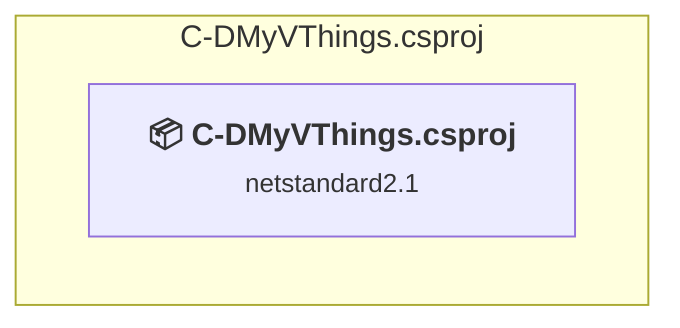

### API Compatibility

| Category | Count | Impact |
| :--- | :---: | :--- |
| 🔴 Binary Incompatible | 0 | High - Require code changes |
| 🟡 Source Incompatible | 0 | Medium - Needs re-compilation and potential conflicting API error fixing |
| 🔵 Behavioral change | 0 | Low - Behavioral changes that may require testing at runtime |
| ✅ Compatible | 16134 |  |
| ***Total APIs Analyzed*** | ***16134*** |  |

### 078 - CDMyOPCUAClient\CDMyOPCUAClient\CDMyOPCUAClient.csproj

#### Project Info

- **Current Target Framework:** netstandard2.1✅
- **SDK-style**: True
- **Project Kind:** ClassLibrary
- **Dependencies**: 0
- **Dependants**: 0
- **Number of Files**: 13
- **Number of Files with Incidents**: 3
- **Lines of Code**: 11228
- **Estimated LOC to modify**: 7+ (at least 0.1% of the project)

#### Dependency Graph

Legend:
📦 SDK-style project
⚙️ Classic project

### API Compatibility

| Category | Count | Impact |
| :--- | :---: | :--- |
| 🔴 Binary Incompatible | 0 | High - Require code changes |
| 🟡 Source Incompatible | 0 | Medium - Needs re-compilation and potential conflicting API error fixing |
| 🔵 Behavioral change | 7 | Low - Behavioral changes that may require testing at runtime |
| ✅ Compatible | 17080 |  |
| ***Total APIs Analyzed*** | ***17087*** |  |

### 079 - CDMyMessages\C-DMyMessages\C-DMyMessages.csproj

#### Project Info

- **Current Target Framework:** netstandard2.1✅
- **SDK-style**: True
- **Project Kind:** ClassLibrary
- **Dependencies**: 0
- **Dependants**: 0
- **Number of Files**: 3
- **Number of Files with Incidents**: 1
- **Lines of Code**: 722
- **Estimated LOC to modify**: 4+ (at least 0.6% of the project)

#### Dependency Graph

Legend:
📦 SDK-style project
⚙️ Classic project

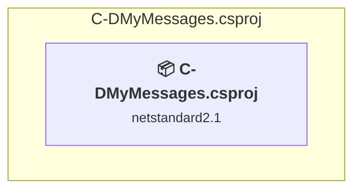

### API Compatibility

| Category | Count | Impact |
| :--- | :---: | :--- |
| 🔴 Binary Incompatible | 0 | High - Require code changes |
| 🟡 Source Incompatible | 0 | Medium - Needs re-compilation and potential conflicting API error fixing |
| 🔵 Behavioral change | 4 | Low - Behavioral changes that may require testing at runtime |
| ✅ Compatible | 1639 |  |
| ***Total APIs Analyzed*** | ***1643*** |  |

### 093 - CDMyNetwork\C-DMyNetwork\C-DMyNetwork.csproj

#### Project Info

- **Current Target Framework:** netstandard2.1✅
- **SDK-style**: True
- **Project Kind:** ClassLibrary
- **Dependencies**: 0
- **Dependants**: 0
- **Number of Files**: 4
- **Lines of Code**: 658
- **Estimated LOC to modify**: 0+ (at least 0.0% of the project)

#### Dependency Graph

Legend:
📦 SDK-style project
⚙️ Classic project

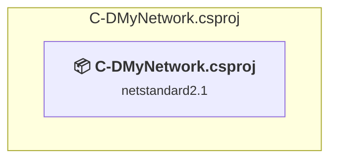

### API Compatibility

| Category | Count | Impact |
| :--- | :---: | :--- |
| 🔴 Binary Incompatible | 0 | High - Require code changes |
| 🟡 Source Incompatible | 0 | Medium - Needs re-compilation and potential conflicting API error fixing |
| 🔵 Behavioral change | 0 | Low - Behavioral changes that may require testing at runtime |
| ✅ Compatible | 1290 |  |
| ***Total APIs Analyzed*** | ***1290*** |  |

### 103 - CMyVisitorLog\C-DMyVisitorLog\C-DMyVisitorLog.csproj

#### Project Info

- **Current Target Framework:** netstandard2.1✅
- **SDK-style**: True
- **Project Kind:** ClassLibrary
- **Dependencies**: 0
- **Dependants**: 0
- **Number of Files**: 3
- **Number of Files with Incidents**: 2
- **Lines of Code**: 617
- **Estimated LOC to modify**: 9+ (at least 1.5% of the project)

#### Dependency Graph

Legend:
📦 SDK-style project
⚙️ Classic project

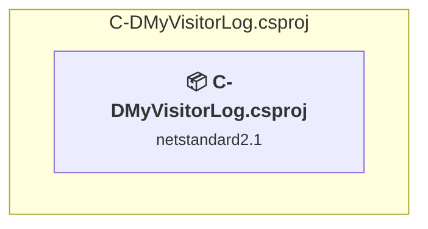

### API Compatibility

| Category | Count | Impact |
| :--- | :---: | :--- |
| 🔴 Binary Incompatible | 0 | High - Require code changes |
| 🟡 Source Incompatible | 0 | Medium - Needs re-compilation and potential conflicting API error fixing |
| 🔵 Behavioral change | 9 | Low - Behavioral changes that may require testing at runtime |
| ✅ Compatible | 1295 |  |
| ***Total APIs Analyzed*** | ***1304*** |  |

### 123 - CDMyModbus\CDMyModbus\CDMyModbus.csproj

#### Project Info

- **Current Target Framework:** netstandard2.1✅
- **SDK-style**: True
- **Project Kind:** ClassLibrary
- **Dependencies**: 0
- **Dependants**: 0
- **Number of Files**: 74
- **Number of Files with Incidents**: 4
- **Lines of Code**: 8880
- **Estimated LOC to modify**: 72+ (at least 0.8% of the project)

#### Dependency Graph

Legend:
📦 SDK-style project
⚙️ Classic project

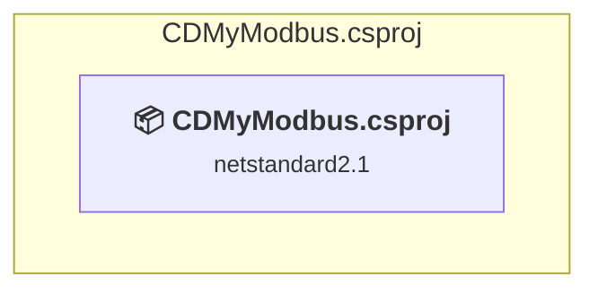

### API Compatibility

| Category | Count | Impact |
| :--- | :---: | :--- |
| 🔴 Binary Incompatible | 0 | High - Require code changes |
| 🟡 Source Incompatible | 72 | Medium - Needs re-compilation and potential conflicting API error fixing |
| 🔵 Behavioral change | 0 | Low - Behavioral changes that may require testing at runtime |
| ✅ Compatible | 9645 |  |
| ***Total APIs Analyzed*** | ***9717*** |  |

### 123 - CDMyModbus\NModbus4Shared\NModbus4Shared.shproj

#### Project Info

- **Current Target Framework:** netcore4.5.1
- **Proposed Target Framework:** net10.0
- **SDK-style**: True
- **Project Kind:** DotNetCoreApp
- **Dependencies**: 0
- **Dependants**: 0
- **Number of Files**: 61
- **Number of Files with Incidents**: 1
- **Lines of Code**: 6245
- **Estimated LOC to modify**: 0+ (at least 0.0% of the project)

#### Dependency Graph

Legend:
📦 SDK-style project
⚙️ Classic project

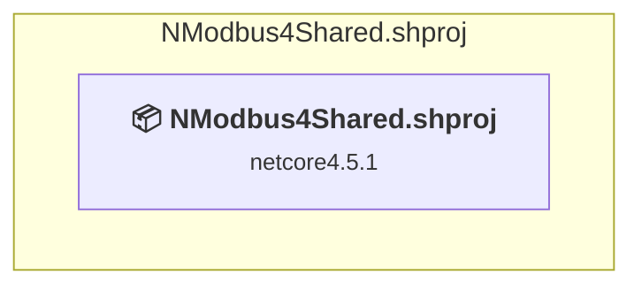

### API Compatibility

| Category | Count | Impact |
| :--- | :---: | :--- |
| 🔴 Binary Incompatible | 0 | High - Require code changes |
| 🟡 Source Incompatible | 0 | Medium - Needs re-compilation and potential conflicting API error fixing |
| 🔵 Behavioral change | 0 | Low - Behavioral changes that may require testing at runtime |
| ✅ Compatible | 0 |  |
| ***Total APIs Analyzed*** | ***0*** |  |

### 149 - CDMyRulesEngine\CDMyRulesEngine\CDMyRulesEngine.csproj

#### Project Info

- **Current Target Framework:** netstandard2.1✅
- **SDK-style**: True
- **Project Kind:** ClassLibrary
- **Dependencies**: 0
- **Dependants**: 0
- **Number of Files**: 3
- **Lines of Code**: 1216
- **Estimated LOC to modify**: 0+ (at least 0.0% of the project)

#### Dependency Graph

Legend:
📦 SDK-style project
⚙️ Classic project

### API Compatibility

| Category | Count | Impact |
| :--- | :---: | :--- |
| 🔴 Binary Incompatible | 0 | High - Require code changes |
| 🟡 Source Incompatible | 0 | Medium - Needs re-compilation and potential conflicting API error fixing |
| 🔵 Behavioral change | 0 | Low - Behavioral changes that may require testing at runtime |
| ✅ Compatible | 3380 |  |
| ***Total APIs Analyzed*** | ***3380*** |  |

### 150 - CDMyMSSQL\CDMyMSSQL\CDMyMSSQLStorage.csproj

#### Project Info

- **Current Target Framework:** netstandard2.1✅
- **SDK-style**: True
- **Project Kind:** ClassLibrary
- **Dependencies**: 0
- **Dependants**: 0
- **Number of Files**: 14
- **Number of Files with Incidents**: 2
- **Lines of Code**: 4835
- **Estimated LOC to modify**: 127+ (at least 2.6% of the project)

#### Dependency Graph

Legend:
📦 SDK-style project
⚙️ Classic project

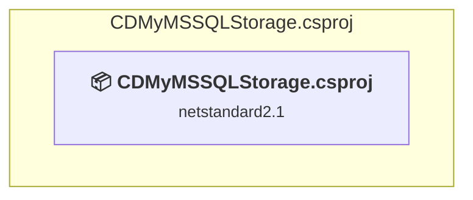

### API Compatibility

| Category | Count | Impact |
| :--- | :---: | :--- |
| 🔴 Binary Incompatible | 0 | High - Require code changes |
| 🟡 Source Incompatible | 127 | Medium - Needs re-compilation and potential conflicting API error fixing |
| 🔵 Behavioral change | 0 | Low - Behavioral changes that may require testing at runtime |
| ✅ Compatible | 10168 |  |
| ***Total APIs Analyzed*** | ***10295*** |  |

### 151 - CDMyWebRelay\CDMyWebRelay\CDMyWebRelay.csproj

#### Project Info

- **Current Target Framework:** netstandard2.1✅
- **SDK-style**: True
- **Project Kind:** ClassLibrary
- **Dependencies**: 0
- **Dependants**: 0
- **Number of Files**: 3
- **Number of Files with Incidents**: 1
- **Lines of Code**: 645
- **Estimated LOC to modify**: 47+ (at least 7.3% of the project)

#### Dependency Graph

Legend:
📦 SDK-style project
⚙️ Classic project

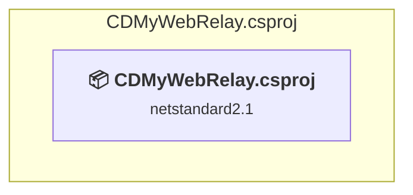

### API Compatibility

| Category | Count | Impact |
| :--- | :---: | :--- |
| 🔴 Binary Incompatible | 0 | High - Require code changes |
| 🟡 Source Incompatible | 0 | Medium - Needs re-compilation and potential conflicting API error fixing |
| 🔵 Behavioral change | 47 | Low - Behavioral changes that may require testing at runtime |
| ✅ Compatible | 1761 |  |
| ***Total APIs Analyzed*** | ***1808*** |  |

### 160 - CDMyImages\CDMyImages\CDMyImages.csproj

#### Project Info

- **Current Target Framework:** netstandard2.1✅
- **SDK-style**: True
- **Project Kind:** ClassLibrary
- **Dependencies**: 0
- **Dependants**: 0
- **Number of Files**: 2
- **Lines of Code**: 244
- **Estimated LOC to modify**: 0+ (at least 0.0% of the project)

#### Dependency Graph

Legend:
📦 SDK-style project
⚙️ Classic project

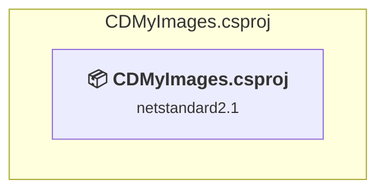

### API Compatibility

| Category | Count | Impact |
| :--- | :---: | :--- |
| 🔴 Binary Incompatible | 0 | High - Require code changes |
| 🟡 Source Incompatible | 0 | Medium - Needs re-compilation and potential conflicting API error fixing |
| 🔵 Behavioral change | 0 | Low - Behavioral changes that may require testing at runtime |
| ✅ Compatible | 565 |  |
| ***Total APIs Analyzed*** | ***565*** |  |

### 175 - ThingProvisioning\CDMyThingProvisioning\CDMyThingProvisioning.csproj

#### Project Info

- **Current Target Framework:** netstandard2.1✅
- **SDK-style**: True
- **Project Kind:** ClassLibrary
- **Dependencies**: 0
- **Dependants**: 0
- **Number of Files**: 1
- **Lines of Code**: 707
- **Estimated LOC to modify**: 0+ (at least 0.0% of the project)

#### Dependency Graph

Legend:
📦 SDK-style project
⚙️ Classic project

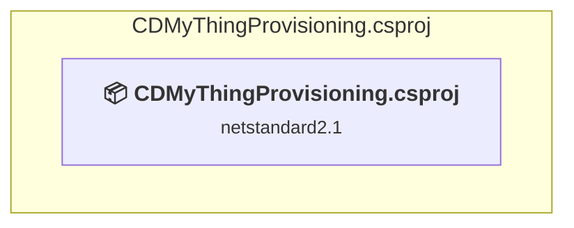

### API Compatibility

| Category | Count | Impact |
| :--- | :---: | :--- |
| 🔴 Binary Incompatible | 0 | High - Require code changes |
| 🟡 Source Incompatible | 0 | Medium - Needs re-compilation and potential conflicting API error fixing |
| 🔵 Behavioral change | 0 | Low - Behavioral changes that may require testing at runtime |
| ✅ Compatible | 1431 |  |
| ***Total APIs Analyzed*** | ***1431*** |  |

### 178 - External Logger\CDMyLogger\CDMyLogger.csproj

#### Project Info

- **Current Target Framework:** netstandard2.1✅
- **SDK-style**: True
- **Project Kind:** ClassLibrary
- **Dependencies**: 0
- **Dependants**: 0
- **Number of Files**: 10
- **Number of Files with Incidents**: 2
- **Lines of Code**: 2133
- **Estimated LOC to modify**: 12+ (at least 0.6% of the project)

#### Dependency Graph

Legend:
📦 SDK-style project
⚙️ Classic project

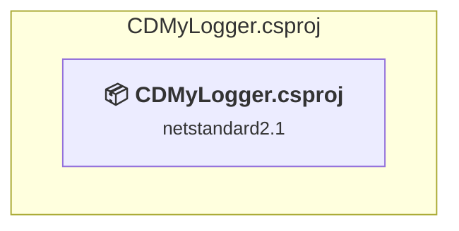

### API Compatibility

| Category | Count | Impact |
| :--- | :---: | :--- |
| 🔴 Binary Incompatible | 0 | High - Require code changes |
| 🟡 Source Incompatible | 0 | Medium - Needs re-compilation and potential conflicting API error fixing |
| 🔵 Behavioral change | 12 | Low - Behavioral changes that may require testing at runtime |
| ✅ Compatible | 3784 |  |
| ***Total APIs Analyzed*** | ***3796*** |  |

### 179 - Mesh Sender\CDMyMeshSender\CDMyMeshSender.csproj

#### Project Info

- **Current Target Framework:** netstandard2.1✅
- **SDK-style**: True
- **Project Kind:** ClassLibrary
- **Dependencies**: 0
- **Dependants**: 0
- **Number of Files**: 3
- **Lines of Code**: 1766
- **Estimated LOC to modify**: 0+ (at least 0.0% of the project)

#### Dependency Graph

Legend:
📦 SDK-style project
⚙️ Classic project

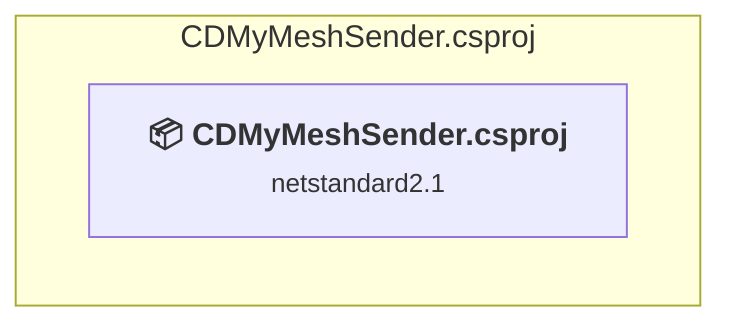

### API Compatibility

| Category | Count | Impact |
| :--- | :---: | :--- |
| 🔴 Binary Incompatible | 0 | High - Require code changes |
| 🟡 Source Incompatible | 0 | Medium - Needs re-compilation and potential conflicting API error fixing |
| 🔵 Behavioral change | 0 | Low - Behavioral changes that may require testing at runtime |
| ✅ Compatible | 12817 |  |
| ***Total APIs Analyzed*** | ***12817*** |  |

### 180 - Mesh Receiver\CDMyMeshReceiver\CDMyMeshReceiver.csproj

#### Project Info

- **Current Target Framework:** netstandard2.1✅
- **SDK-style**: True
- **Project Kind:** ClassLibrary
- **Dependencies**: 0
- **Dependants**: 0
- **Number of Files**: 2
- **Number of Files with Incidents**: 1
- **Lines of Code**: 961
- **Estimated LOC to modify**: 1+ (at least 0.1% of the project)

#### Dependency Graph

Legend:
📦 SDK-style project
⚙️ Classic project

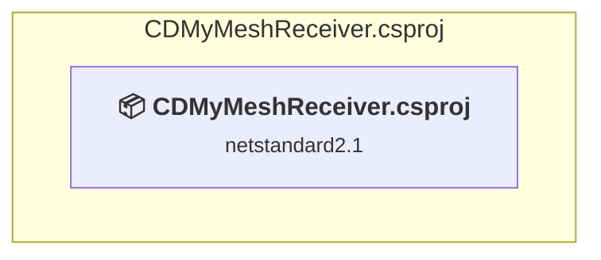

### API Compatibility

| Category | Count | Impact |
| :--- | :---: | :--- |
| 🔴 Binary Incompatible | 0 | High - Require code changes |
| 🟡 Source Incompatible | 1 | Medium - Needs re-compilation and potential conflicting API error fixing |
| 🔵 Behavioral change | 0 | Low - Behavioral changes that may require testing at runtime |
| ✅ Compatible | 4176 |  |
| ***Total APIs Analyzed*** | ***4177*** |  |

### 182 - MQTT Sender\CDMyMqttSender\CDMyMqttSender.csproj

#### Project Info

- **Current Target Framework:** netstandard2.1✅
- **SDK-style**: True
- **Project Kind:** ClassLibrary
- **Dependencies**: 1
- **Dependants**: 0
- **Number of Files**: 2
- **Number of Files with Incidents**: 2
- **Lines of Code**: 1320
- **Estimated LOC to modify**: 3+ (at least 0.2% of the project)

#### Dependency Graph

Legend:
📦 SDK-style project
⚙️ Classic project

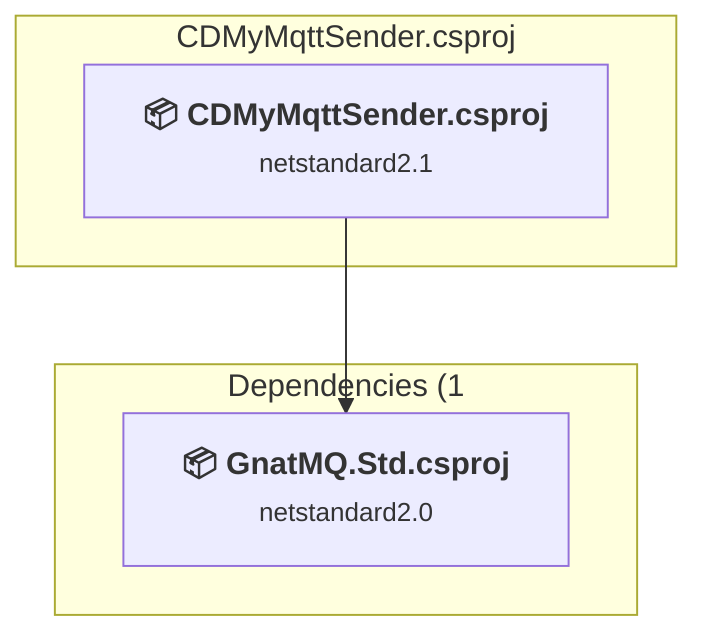

### API Compatibility

| Category | Count | Impact |
| :--- | :---: | :--- |
| 🔴 Binary Incompatible | 0 | High - Require code changes |
| 🟡 Source Incompatible | 1 | Medium - Needs re-compilation and potential conflicting API error fixing |
| 🔵 Behavioral change | 2 | Low - Behavioral changes that may require testing at runtime |
| ✅ Compatible | 12400 |  |
| ***Total APIs Analyzed*** | ***12403*** |  |

### 182 - MQTT Sender\GnatMQ\GnatMQ.Std.csproj

#### Project Info

- **Current Target Framework:** netstandard2.0✅
- **SDK-style**: True
- **Project Kind:** ClassLibrary
- **Dependencies**: 0
- **Dependants**: 1
- **Number of Files**: 50
- **Number of Files with Incidents**: 2
- **Lines of Code**: 9640
- **Estimated LOC to modify**: 5+ (at least 0.1% of the project)

#### Dependency Graph

Legend:
📦 SDK-style project
⚙️ Classic project

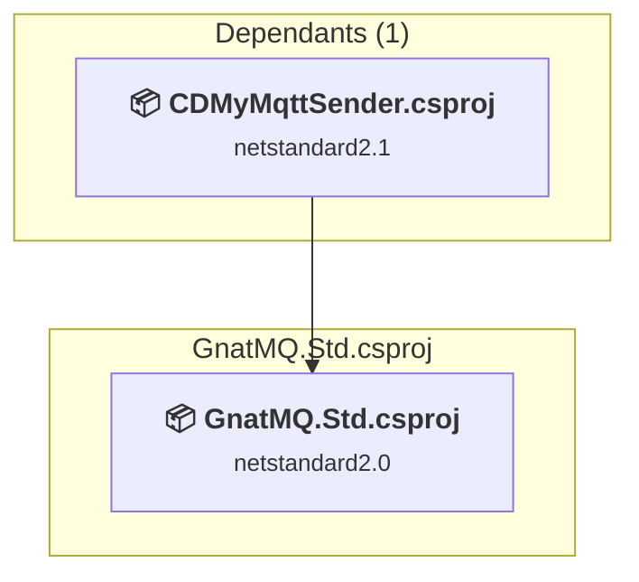

### API Compatibility

| Category | Count | Impact |
| :--- | :---: | :--- |
| 🔴 Binary Incompatible | 0 | High - Require code changes |
| 🟡 Source Incompatible | 3 | Medium - Needs re-compilation and potential conflicting API error fixing |
| 🔵 Behavioral change | 2 | Low - Behavioral changes that may require testing at runtime |
| ✅ Compatible | 9330 |  |
| ***Total APIs Analyzed*** | ***9335*** |  |

### 188 - PrometheusExporter\CDMyPrometheusExporter\CDMyPrometheusExporter.csproj

#### Project Info

- **Current Target Framework:** netstandard2.1✅
- **SDK-style**: True
- **Project Kind:** ClassLibrary
- **Dependencies**: 0
- **Dependants**: 0
- **Number of Files**: 3
- **Number of Files with Incidents**: 1
- **Lines of Code**: 1118
- **Estimated LOC to modify**: 2+ (at least 0.2% of the project)

#### Dependency Graph

Legend:
📦 SDK-style project
⚙️ Classic project

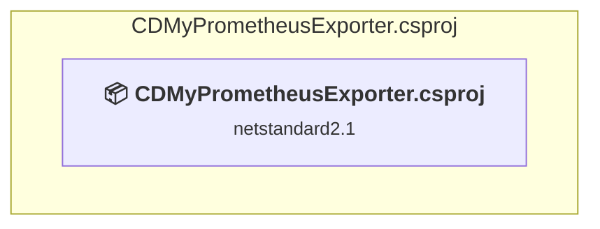

### API Compatibility

| Category | Count | Impact |
| :--- | :---: | :--- |
| 🔴 Binary Incompatible | 0 | High - Require code changes |
| 🟡 Source Incompatible | 0 | Medium - Needs re-compilation and potential conflicting API error fixing |
| 🔵 Behavioral change | 2 | Low - Behavioral changes that may require testing at runtime |
| ✅ Compatible | 12072 |  |
| ***Total APIs Analyzed*** | ***12074*** |  |

